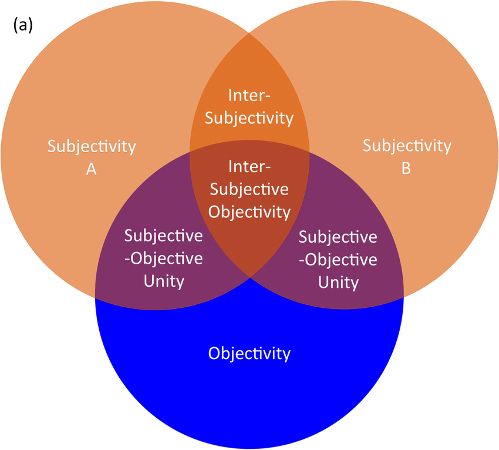
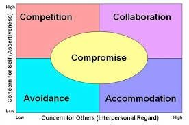
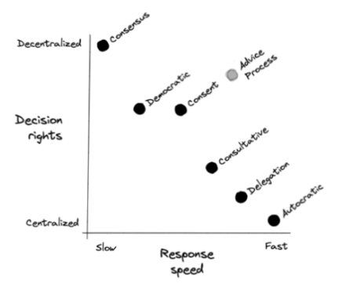

*…And how that’s not necessarily a “bad” thing.*

The winds of change give us an opportunity to strengthen the structures that sustain us. They help us define what’s important in the grand scheme of things.

In complex systems, ***what you deem essential to maintain \*****who you think you are\* — ****to sustain your identity — comes into play***. It becomes a very important driver (and predictor) of behavior.

**Let’s break it down:** Your reason for being sets how you define yourself. The attributes you choose to focus on, to lock, and to evolve or outright change the configuration your worldview.

In other words you say “I am X” or “I am someone who does X” sets characteristics that are attached to your identity. Statements like this create a narrative that defines certain behaviors, beliefs, and intentions… A mental map is formed. That map can change. It changes when you interact with people who think, speak, and act differently from you. Essentially all interactions and experiences are identity “honing” events. Of course some are greater than others.

### Diversity helps us define our identity as we relate to others.

How we choose to respond to unexpected and varying input — to ideas and beliefs that are NOT like our own, is something that can make or break an identity.

Behavior is an observable lynchpin that connects your identity, your beliefs, and your narratives — to what you think is essential within a larger context of meaning.

### Breaking Changes — How we approach events defines our character.

*What’s your personal logic? What happens to your systems — inside your body or those social and technical systems you work within every day?*

- Do you or your systems shut down?
- Do you get angry? Do you start accusing or attacking others? Start throwing unexpected errors?
- Do you try to control what others are doing? Attempt to force the input into some other format?
- Do your rules of engagement include getting what you want at all costs or valuing interpersonal relationships?
- Do you take things in stride and really buckle down on those input mechanisms, your listening and resolution skills? Are there escalation policies that help the system evolve and change, to handle new information?

* * *

Some of the recent shifts in the tech job market as well as in the awareness of racism and sexism in our culture and in the marketplace at large are really highlighting conflict resolution skills right now.

People who speak out, who act with integrity and value others respond and are treated very differently from those who respond with fear, who ignore input, or who attempt to control outcomes. Seeking context is a survival strategy that not everyone employs when in a heightened state of emotional arousal.

* * *

## Anyone who claims to be objective is immediately suspect in my book.

I’ll tell you why.

The world is neither fully an objective or subjective place. Meaning is made within the mind and through the focus of our perspective and our sensory systems.

* * *

### Let me explain.

For us limited humans, the world is larger than pure logic allows.

Something might be more or less objective within a limited and comparatively shared context, but honestly, claims of objectivity are pretty specious . They seem to fall along the upper-end of a spectrum of privilege and control.

The question is essentially “If everyone is color blind does that change how we conceptualize about color?”

What say you? How could that be? What in the ever-loving-fuck does that mean? Well… lets dive in…

* * *

### Impartiality is bunk. Bias always exists.

Objectivity encompasses our shared experience, our perception of objects of cause and effect, the sphere of science and iterative duplication. The world around us includes things that are so unlikely they are essentially impossible to duplicate. The number of variables that went into creating them boggle the mind. Being born, being human, includes many such experiences of that nature.

> If you wish to make an apple pie from scratch, you must first invent the universe. — Carl Sagan

In other words, objectivity is a way of looking at the world of your personal known subjective. It is the sum total of what you perceive. And the known subjective is only a part of your overall existence. There’s a lot that happens outside your internal subjective awareness, let alone what happens beyond your derma, or even your thermal body.

Basically though, because of this, you can be impartial and unbiased only in relation to a limited set of known “other.” And that doesn’t mean you actually are.

### Subjectivity is the entirety of your quality of being.

*[https://www.researchgate.net/figure/Schematic-representation-of-the-inter-subjective-objectivity-model-a-Relations-between\_fig1\_316447034](https://www.researchgate.net/figure/Schematic-representation-of-the-inter-subjective-objectivity-model-a-Relations-between_fig1_316447034)*

The diagram above implies a third-party aware of each of the objective unities of the other (an external observer). Objectivity is actually a combination of the constrained subjectivities of others. Science requires multiple verifiable sources. But its trickier than we like to think to really get at.

> This is also why objectifying others is to deny them the full extent of their humanity.

Our subjective experience is the sum total of who we are and what we choose. Objectivity, by its very nature, cannot acknowledge the full subjective. The only reason we have any concept of objectivity is because, as humans, as animals, as time-bound spatially-limited beings we’re all somewhat aligned within our physical perceptual plane and can observe interactions from constrained “humanoid” lenses.

Just because we can’t observe something doesn’t mean it didn’t happen.

### Privilege and Control

Access to resources determines your amount of privilege and control. Those particles have a level of access that we likely cannot jailbreak. And our access to the universe of experience of another human’s subjective experience is similar. But the more you understand about yourself and your own mind and body the more privilege and control you have over your own experience.

## Tempus nosce

### True Power

Your personal experience encompasses, to a greater or lesser extent, your understanding of objective reality.

What you choose and observe, how you act and what you believe, etc., in concert and collaboration with the shared experience of others, is part engineering (the practical use of the objective) and part ritual (the practical use of the subjective).

Your perception is what you choose to take in and to exclude within your personal subjective experience. It encompasses what you know of objective reality, but not all objective realities.

Perception, ultimately, is the result of the study and practical use of the subjective — of making sense of your world. Perception includes logic, reason, intuition, choice, belief, intent, and story. *Read that again.*

### Perception includes logic, reason, intuition, choice, belief, intent, and story.

In very clear terms “understanding” involves all of these tools. They are how humans make sense of the world — how we observe and act. You discount any one of them at your mortal peril and they all combine into something that either aligns with who you understand yourself to be, or not.

You have a reflexive relationship (relational, self-adjusting feedback mechanism) with your own subjectivity and your own perceptions.

You learn and change in response to new information. Emotions are the result of our senses being filtered through our perception tools and also act as feedback mechanisms. They can really muddy things up at times when there is conflict between them. And that means there’s opportunity to clarify understanding as well — to build a better filtering system.

### Me vs We vs You vs Them

Discounting the fact that your logic, reason, intuition, choice, belief, intent, and story may significantly differ from another person’s can put you at odds. It can bring both conflict and opportunity.

You can choose to broaden your horizons and create a relationship — a shared sense of meaning and definition, or redraw and assert boundaries. Either way, meaning is changed, purpose is redrawn and goals shift — again, there’s a reflexive relationship that occurred regardless.

Feelings are the sum total of someone’s perceptions at any given moment. Where they are in conflict lies wisdom (often under six feet of dirt).

* * *

Internally or externally — within oneself or in a broader system, conflict means that certain feelings or needs may be unheard, ignored, diametrically opposed or possibly have not been integrated into an inter-objective system.

Maybe now you can see it a bit more clearly. [Conflict is what demarcates and defines an organism](https://waitbutwhy.com/2019/08/fire-light.html). Conflict can also be something that helps an organism to grow. Where there is conflict there is a boundary. That can be ideological, emotional, or physical. Conflict lives at the limits of identity and within the perception of competing needs.

At the most basic level, the resolution of conflict means death to the old you, along with the birth of a new you — one that is able to grow and hold a greater amount of diversity with integrity.

### So, how you handle conflict IS something that defines (and redefines) YOU.

* * *

## With Great Power Comes Great Responsibility…

**…and other appropriate aphorisms that come along with claims of objectivity.**

Now that you know all this how will you choose to deal with conflict in yourself and in others?

* * *

## The Five Conflict Management Styles

* * *

Here is an overview of five main categories of conflict management:

*Competition, Collaboration, Avoidance, Accommodation, Compromise [https://wheatandtares.org/2013/05/14/mormon-passive-aggression/](https://wheatandtares.org/2013/05/14/mormon-passive-aggression/)*

### Consensus & Collaboration. (win-win)

This is your Ideal optimization. People get what they want; negative feelings are minimized.

Remember, those feelings are a result of the sum of someone’s perceptions of the world around them. They are categorically important information to calibrate.

Collaboration brings many different views together to create a greater understanding and sense of a whole. Thinking that frames collaboration in a two-sides mindset is discouraged. Visual Maps can really help this along.

*Pros*: High mutual trust, builds commitment and admiration. Ideas are challenged and creative solutions can be applied.

*Cons*: Time and energy consuming. Collaboration requires parties to clearly express feelings (senses), needs, and to listen well and communicate clearly.

***Advice Process (win-win)***

Try gathering advice from the experts rather than everyone. Balance speedy and rigorous decision-making with compassionate collaboration and peer-reviewed discussion across a specific set of expertise and roles. Create an open and supportive environment where diverse perspectives thrive in conversation. Build a learning environment where trust, accountability and psychological safety grow over time. Seek to support the community to gather and organize knowledge.

*Pros*: Fast. Less time and energy consuming than full collaboration

*Cons*: Not quite as fast as Command and Control style.

**Facilitating Software Architecture by Andrew Harmel-Law**

### Compete. (win-lose)

Command-and Control style. Non-cooperative, assertive and authoritarian. Hierarchical. Includes force of will from one party upon another.

This is often chosen from a survival mindset based in fear of loss rather than thriving.

*Pros*: Fast

*Cons*: Can lead to aggression. Breaks trust, reduces engagement and commitment, breeds hostility. Can break consent and reduce perception.

**Avoid**. (*lose-lose*)

Conflict is not addressed. Choosing this can be a refusal to address misalignment. No differences are integrated into the systems.

*Pros:* Postpones the difficulty. Can be useful where issues may self-resolve or where resolution is not currently possible.

*Cons:* Postponing can cause pressure and escalation over time. Can lead to aggression. Problems go unaddressed and unresolved. In adaptive systems engagement decreases over time.

### Accommodate. (lose-win)

One side gives in to maintain the relationship.

*Pros*: Minimizes injury when one side is more powerful; relationships are maintained at a cost. Can be used to equalize power relationships.

*Cons*: Can lead to aggression. Breeds resentment, can be used to exploit weakness. Rather than one side imposing his/her will on the other party, one person suborns or aligns their own interests in favor of “keeping the peace” by meeting the other person’s needs.

### Compromise. (partial win-partial win)

This is a middle ground approach that might include any or all of the other conflict styles. Power relationships generally need to be equalized for this to work.

*Pros*: Useful in complex situations with no simple solutions, all parties need to be treated equally and feelings must align.

*Cons*: Can lead to passive-aggression. No one is ever really satisfied; yields suboptimal solutions. In this approach, both parties’ needs are known, but a solution requires that each one give up something. Some needs of both are met in the process.

* * *

## Automating Evaluation — Responding over Reacting

In order to address conflict you may have to let go of who you think you are and adapt to a changing situation. This means that conflict and diversity can actually threaten who you *think* you are. When your perception of yourself is threatened we often react with anger.

Dealing with this kind of anger means breathing slowly, ritualizing self-soothing behaviors, developing compassion, making sure you’re rested and unhungry — even taking cold showers can help us work through strong emotions. All systems need ways of handling input outside normal parameters.

Our body’s responses can be redirected using many proven techniques from psychology and neuroscience along with ancient cultural practices.

The trick is to get yourself and those who you want to integrate with to feel safe enough to do so. When inputs and outputs are handled well it makes building a common set of definitions and meaning possible. There’s space enough in finding common ground and interests, and it becomes possible to build a learning zone.

* * *

### Notes to discuss

The more diverse perspectives you get in a situation — and if all the people feel brave enough — the more pushing and pulling you’ll get. This will define what you actually want in your groups.

Creating psychologically brave spaces clears the air, and the room and gives enough space for people to learn and grow and address diverse points of view that may seem to conflict initially.

When you create a psychologically safe space for long enough eventually you’ll end up with people challenging themselves in brave ways that put everyone inside the learning zone, safety putting you in a place to have these conversations.

- How you deal with conflict defines who you are in relation to others.
- How a system handles external input defines the system boundaries.
- What you choose changes you and how others approach you.

And this is *why Love Labs*.
