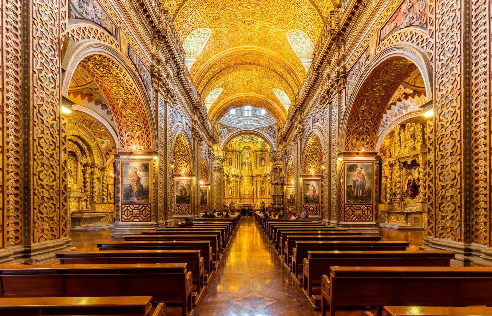
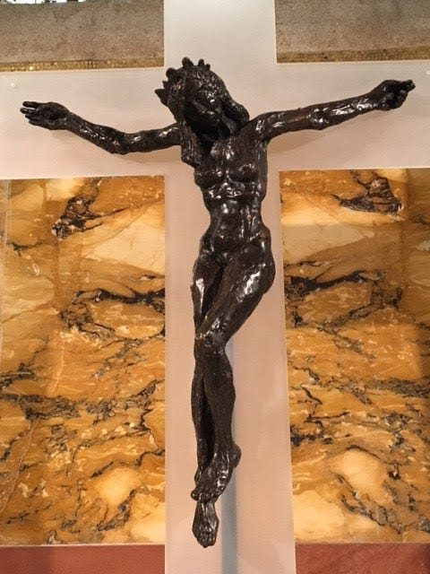
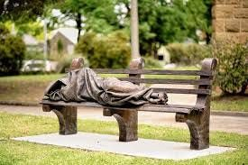
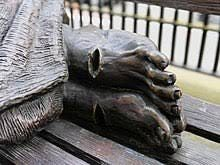
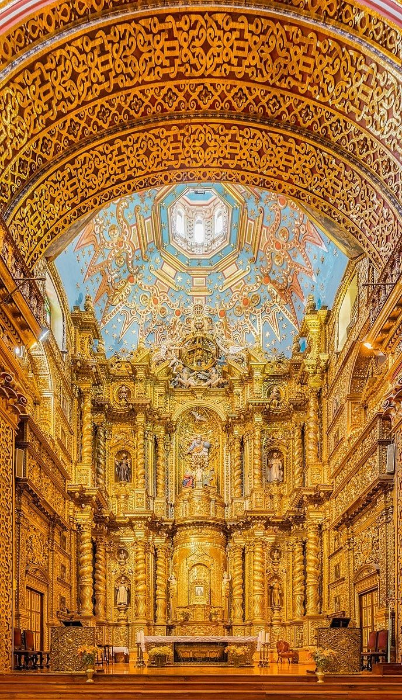

I fell asleep watching [YouTube](https://youtu.be/YvKswhesRaI) (1:51:13) and woke up to the Inca being destroyed by the conquistadors.

The strange smile on the narrator’s face. The weight of his words not really resonating within his voice.

The Incas filled three huge rooms to ransom their leader with the sweat of the sun (the name for gold) and the tears of the moon (silver). Pizzaro strangled him when they were done.

This stained history is me. And I feel my teeth gnash and heart fire. Relive what I see happened in my minds eye. Feel it. Relive being choked, choking, the fear and rage and pain of millions of displaced, murdered souls, of countless others in the desecration of self.

Embrace it all. Calm all fear. Nourish your senses.

I opened my eyes to see this [cathedral](https://www.atlasobscura.com/places/iglesia-de-la-compania-de-jesus). That gold was used, in part, to adorn this baroque cathedral that aggrandizes the glory of Jesus Christ. What a spectacle!

The psychopathy of the things done in the name of Christos. The beliefs we’ve held that allowed the trail of tears, rape and murders, pograms, witch hunts, the Holocaust, Israel, Palestine, Babylon, Midian… becoming named and unnamed, through wars in the name of… *whatever*.

The apathy and dissociation of the slow death.

To *other* any part of life. In small ways and big. All the “isms,” abstractions, and labels we use to vector force change.

To murder so many others. For who they are or aren’t. For who they love or how they look. For the women, the children, the BIPOC and LGBTQIA communities even still, to abuse and murder and “reeducate” our children. It is staggeringly, torturously, unconscious. The ways we treat our canvas, our land, our home. Our Eden.

The meaning we make and the love we show for one another.

**The Christa Project**

This cathedral displays the glory of Jesus like the walls of an abattoir displays our love of animals. A charnel house for our love of life.

Awareness brings compassion and nuance.

shock -> disbelief -> anger -> sadness -> 
acceptance -> forgiveness -> gratitude -> flow

Bathed in the blood of Christ, the blood of life. The trails we leave are tears. Drying rivulets of rain, of blood, of wildflowers and worshippers in a field. The Pain, the Trust, the Truth. The mistrust and the abandoning of self and the mind.

All for thou. All in thy name.

I Love You.

* * *

All for Thou
All in Thy Name
Guilty Guilty Guilty
all to Glory
Hallelujah Hallelujah Hallelujah
all for All, always
the sweat of the sun
the tears of the moon
the rape of the Divine
the ravishing of our humanity
of our innocence
Holy Holy Holy
of the wilds within
gas chambers
warning us
warming us
upon the trail of tears
at the bottom of mass graves
i for I
found murderous lies
sexual assault
domestic violence
fratricide, infanticide
crimes against humanity
feel it now
feel it here
the pain and suffering
let it live within you
in this filthy grail
let that pain wrack your body
haunt your mind
Oh! God All-Mighty!
in testament
understand
connect
stay connected
how it happened
how we let it happen again
and to step into
the recognition
that allows us
to be
come dream
a new dream
awake with me

* * *

[Awakening](https://youtu.be/uUZJea1UnS8)

*Turn and look where you dare not look. Our shadows control us when we run from them. I’m grateful for this sacred pain even as I wish it weren’t who we are.*
