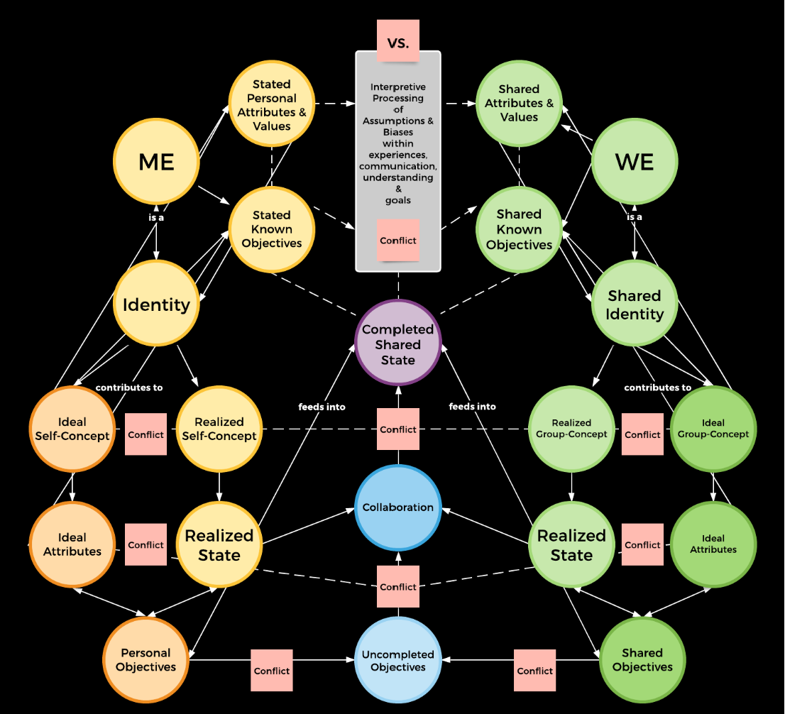

*What doesn’t kill you … creates collective trauma*

* * *

I heard about the concept of a [Witch Wound](https://rebeccaclegg.com/the-witch-wound/) last night. It makes a lot of sense that the collective trauma from people (especially women, natives, the neurodiverse, and queer) speaking about subjective, intuitive and spiritual matters would affect so many of us today.

[Embedded media](https://www.youtube.com/embed/tVGbd0p_p1E?feature=oembed)

We need to heal that shit. Calling or implying someone is “crazy,” “witch,” or “bitch” with this in mind and you begin to see how much more weight it carries.

Remember the New York white lady in the park with the dog calling the police on the black [birdwatcher](https://en.m.wikipedia.org/wiki/Central_Park_birdwatching_incident)? Remember what Reverend Parris’ daughters did to [Tituba](https://www.history.com/news/salem-witch-trials-first-accused-woman-slave) in the Salem witch trials?

Yeah, something a bit like that.

* * *

*Diagram of conflict at play within group and individual dynamics from a talk I gave at MapCamp in 2021*

* * *

## Witch Hunts

Remember what’s been happening to so many strong and outspoken and sexual queer and native and neurodiverse and body-diverse and black and femme folk for, well, pretty much ever? There are so very many examples of witch hunts, even today.

People in marginalized groups are at more risk for being labeled unpredictable, as well as being gaslit by society into instability. It’s a self -reinforcing loop. It can cause a toxic relationship with self.

In addition it carries with it collective memory of a threat of death, restraint, abuse and mutilation. (See links below)

- [Declared Insane for Speaking Up: The Dark American History of Silencing Women Through Psychiatry](https://time.com/6074783/psychiatry-history-women-mental-health/)
- [How Victorian Women Were Oppressed Through the Use of Psychiatry](https://time.com/6074783/psychiatry-history-women-mental-health/)

## Being an individual was a threat to the collective.

Diversity matters for collective survival. Too much unintegrated diversity will collapse a system. There are strategies to mitigate that.

There’s a fundamental mathematical principle (see the [Diversity Prediction Theorem](https://rosettacode.org/wiki/Diversity_prediction_theorem)) at play that shows that groups that integrate different viewpoints into their collective knowledge are more likely to survive the winds of change.

I’ll dive into this further in another blog post I’ve been researching and working on centered on diversity mindsets and active non-confrontation.

## Just Don’t Do It.

So, when it comes to name-calling and accusations like this, Just Don’t Do It. See thoughts like this as an opportunity to learn more or to remove yourself from the equation (this is often what asserting effective boundaries looks like).

If someone seems crazy it means you don’t have enough information about the intersubjective. Calling someone crazy is pusillanimous, disrespectful, and irresponsible. It’s also a limited and controlling, privileged, and hierarchical/paternalistic view on objective reality.

So now that we understand more of our collective fears, maybe we can begin to move past them.

* * *

Go forth and be mindful, respectful, and kind my dear friends…

* * *

## Other Examples

- [Harmful Transgender Health and Safety Laws passed in the U.S.](https://www.lgbtmap.org/equality-maps/nondiscrimination/bathroom_bans)
- [The Rise of Anti-Trans Bills](https://www.reuters.com/graphics/USA-HEALTHCARE/TRANS-BILLS/zgvorreyapd/)
- [Utah Transgender Folx](https://www.nytimes.com/2024/01/31/us/utah-bathroom-ban-transgender.html)
- [Native American Children](https://www.theatlantic.com/education/archive/2019/03/traumatic-legacy-indian-boarding-schools/584293/)
- [Natives](https://news.berkeley.edu/2020/11/19/using-disability-to-imprison-native-americans/)
- Queer and Trans still fight this very openly in most countries. It didn’t stop being labeled as a psychiatric illness until 1987 in the United States.
- [Conversion Therapy](https://www.forbes.com/sites/jamiewareham/2021/03/08/this-is-where-lgbtq-conversion-therapy-is-illegal/) is still a thing
- Neurodiverse people mask. Standing out can get you labeled as a threat.
- [Zelda Fitzgerald](https://www.huffpost.com/entry/zelda-wasnt-crazy_b_3268211) was an outspoken, artistic and intuitive woman who broke the mold and ended up institutionalized, manipulated, and eventually died from it
- There are many others… I’ll keep adding to it as I’m able.
