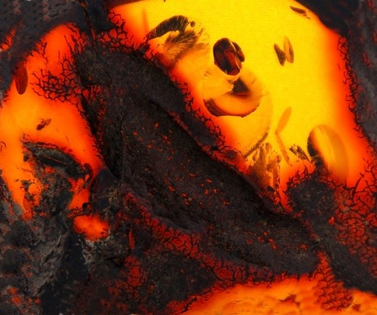

* * *

Frozen droplets flare electric
Spark a rubbed fur hide
Conducting timbered wounds
Sunlight caught, rendered-matter
Stored and bound in time
Expelled as static power

* * *

Gives a dust to singing horse-hair,
Gut and wooden varnish
Changing ink to light to sound,
An inner ear’s vibration
Through grandest halls and chambers
With symphonic fluctuation
