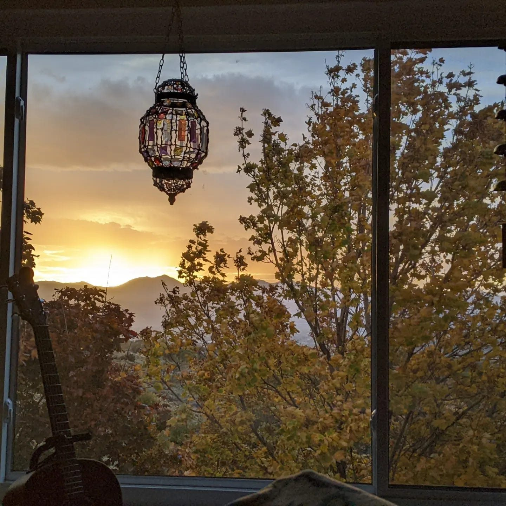
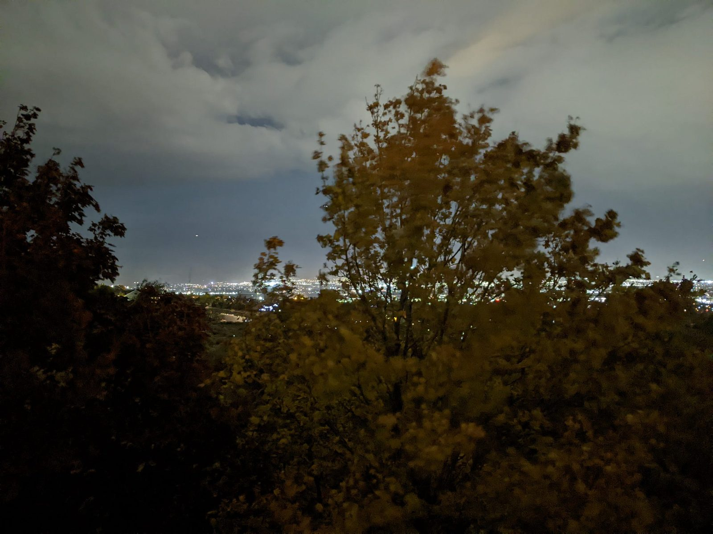

* * *

My autumn heart beats
like the cold draft from the window

* * *

May our days be full of crunching color
like the sun shown through our ancient tapestry

* * *

May the softening light meet us gently
like a mother’s gaze upon our wilting earth

* * *

May the darkness hold our tears
like acorn teacups in the rain

* * *

*202310*

* * *

