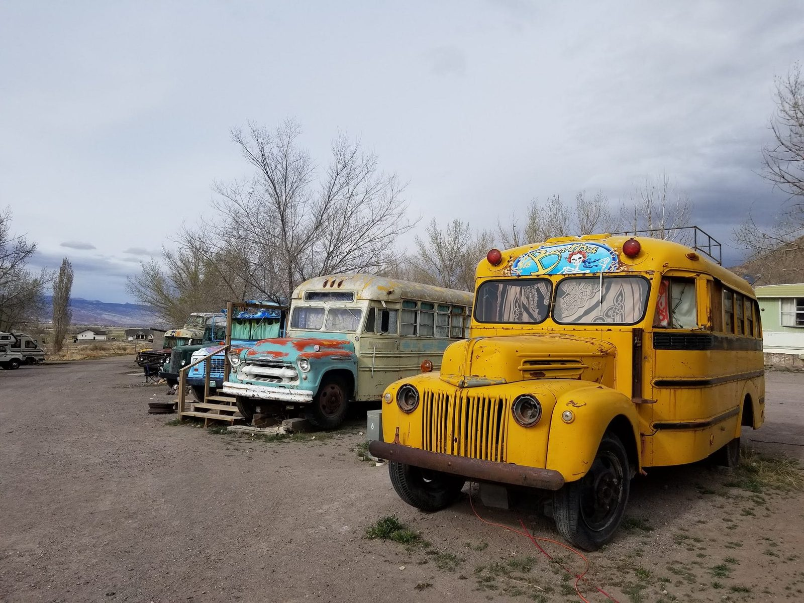
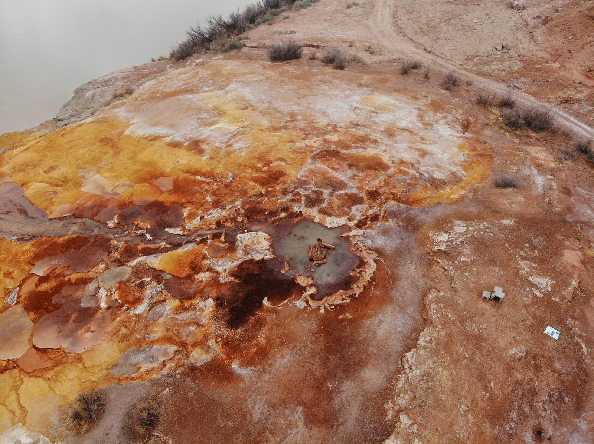

* * *

They called each other, she to them
The lonely and forlorn
Forgotten flock of bussing-friends
. . . . . to each other’s side

* * *

There’s strength in this land
Find peace and cozy comfort
They all called, “Come here,”
. . . . . to the warm-rainbowed garden.

* * *

We can retire, dream and slowly decay,
Where people in love, will love you.
Above the lifeblood bubbling up from
. . . . .this red Earth.

* * *

Old and tired, and not quite done yet,
A determined repose, together and still
Tidy and neat, another kind of working order
. . . . . She’s is proud of her roll

* * *

Doing her best to give care, to provide
Bounty and warmth, for herself and for others,
Such a Lady, a tiny great-grand dame
. . . . . who’s traveled the land

* * *

Her friends came to surround her
And sing of her kindness,
Their beauty, and heart full of iron
. . . . . bleeding red into the land

* * *

They change with the sunlight,
The seasons, the winds
With love and with caring, each day
. . . . . becoming living, soulful things

* * *

Young at heart, an old chassis,
With willing know-how
Rippling and romping, squealing
. . . . . in their second summer

* * *

Some tired and worn and just hanging on.
A creaking backdrop against the changing
Cycles and times. Watching
. . . . . those younger rebuilt joys

* * *

Wondering “What’s it all about?”
There’s music and dancing,
Nature and children, blankets and cuddles,
. . . . . tonics, heat, and light

* * *

There’s no space for harming, for leaving a trace
Murmuring low, “Pack it in, pack it out”
She lights up with awe and finds grace
. . . . . through subtle nudges and cues

* * *

Her dreams reflect the moon and stars in her belly.
Through the blinking windows of her soul
She recalls her past adventures and,
. . . . . in the quiet light, she roars to life

* * *

She conducts with gusto her wind ensemble
To the beat of our grandfather’s storm
Bertha bellows and roars, then softly sighs,
. . . . . crooning to her brood

* * *

Soulful stories, whispered secrets, children grown and gone.
Bullies and bus drivers cranking the gears,
Heeding mechanics hammer and clang,
. . . . . the bellows of laughter, rowdy and playful.

* * *

Of long trips. And broken-down dreams.
The lovers entwined in her bed. Of lace. Of chocolate.
And lighthearted folk who saw her soul and made it brighter,
. . . . . and of those who couldn’t see or hear.

* * *

Of quiet nights full of stars.
Of craftwork and kindnesses done for others.
Of witches and bitches and late night
. . . . . tumble-down drunkards.

* * *

Bright summer campfires,
Echoed laughter and friendships,
Cleaners, and caretakers,
. . . . . and those passing through.

* * *

Cheers for the boom of the roaring March winds
Praise for the gift that they are
Bequeathing your longest, your loudest,
. . . . . your wildest and grandest stories and songs.

* * *

And she obliges, laying a blanket of snow
She loves it all, loves us well, with lullabies
Humming to sleep, harmonizing with
. . . . . such beautiful songs from the wind.

* * *

