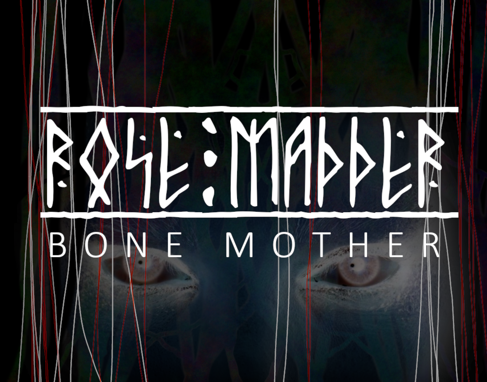

* * *

Bone Mother
Bringer of Death
Muncher of Bone
Hunter of Hunger
Driving the Wind
That Moves the Dunes
That Looses the Way
That Calls the Moon
Bone Mother Come
Free Your Soul
Bone Mother Come
Feed your Dog
Bone Mother Come
Feed me my Bones
I am Bare Bare Bare
Your mind is a Snare
Hunger bites through me now
Hunger bites through me now
Bone Mother Come!
Reign Death down on me
Reign Death down on me
Bone Mother Come
Old Mother Come
Watch me Run away

* * *

*202011*
[https://soundcloud.com/r0zm4ddr/bone-mother](https://soundcloud.com/r0zm4ddr/bone-mother)

* * *

Banshee, Sirens, Selkie are mythological feminine models.

They helped in transition between life and death and birth and sickness.

They chose to do the work of creating balance in the environment acting as a conduit for the transference of energy and systematic differential release in those spaces.

They embody the pain of the surrounding environment and transmute it into sound. They represent pain — the thunder and lightning of the soul. They transmute and create its ozone.

Pain is a complex engine. They simplify it to make more room for love to bloom, for the landscape to heal.

They are the great gardeners of the soul.

Be a banshee.

Siren call your soul from the depths of your being.

Help others learn to do the same.

* * *

Sing something like this:

*What must I give more death to today, in order to generate more life? What do I know should die, but am hesitant to allow to do so? What must die in me in order for me to love? What not-beauty do I fear? Of what use is the power of the not-beautiful to me today? What should die today? What should live? What life am I afraid to give birth to? If not now, when?*

*If we sing the song of consciousness till we feel the burn of truth we can create and hold a burst of firelight in the darkness.*

(Dr. Pinkola-Estes inspired song)
