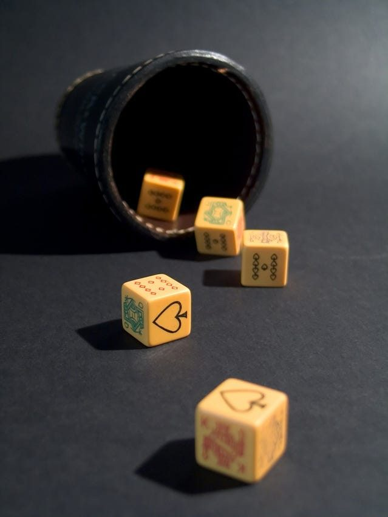

* * *

If I had the gift of divining…
I would tell you all the things
That I see in the future
And what led to them
I would know what words would help
I’d stop you in your tracks before you took
That step
I’d look up instead of down when the other
Shoe dropped
I could see what actions lead to pain
And what would cause us pleasure
Your happiness is important to me
I love to see it on your face,

I’m not divine.
But if I were…
I’d do just the right thing when you needed

Love
Or Scratches

But I don’t,
and I’m not
