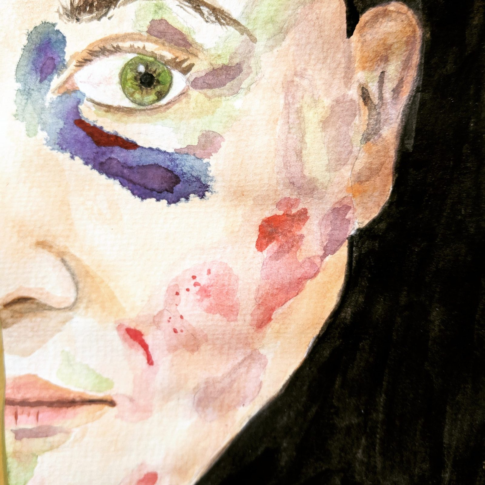
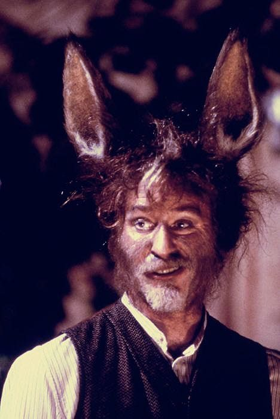

* * *

*“Every criticism, judgment, diagnosis, and expression of anger is the tragic expression of an unmet need.”* — Marshall Rosenberg
[https://www.tiktok.com/@watchfulcoyote/video/7229422895800372522](https://www.tiktok.com/@watchfulcoyote/video/7229422895800372522)

* * *

Dear Lover,
Dear Dead One
Dear Bottom

* * *

9 patient
open months
you wooed my heart

* * *

Before I gave much back
Seems like Kindling
for a tinder box

* * *

I think back to the times
The good so good. Playing together.
Almost 7654321 years Heaven.

* * *

Loving you for your humanness
A crooked tooth, the way you walked
Your voice, your Scars and mannerisms

* * *

So much I cannot name.
Loved so deeply.
Privy to only me.

* * *

To grow stronger, together
Break down the lies
Self-sabotaging habits.

* * *

Find safety in eachothers arms
Inside our hearts
Side by side

* * *

Thank you so much for the
Memories. Lessons.
Truly.

* * *

Wanted to learn more
Learn better
Evolve. Resolve. Revolve.

* * *

What I really wanted
Respect and compassion
Clarity and direct dealings

* * *

What I really needed
Was to know what you wanted
To see where we aligned… and where we didn’t

* * *

It makes sense
And then it doesn’t
There and back again

* * *

Flashing back and forth
Rocked between realities
Polarized Anxious-Avoidant-Disorganized Attachments.

* * *

Ripped between parts
multiple realities
And my own perspective

* * *

The more I look, the more I see
The biggest mistake was not
Leaving when you couldn’t cherish me

* * *

Believing that of course you did
Of course you would and had
When really, it seems you didn’t

* * *

Oh I wish, How I wish
To be proven wrong
Sing Hosha-na Home Again

* * *

Rose-Color Removed.
Connecting the Dots.
Rupture and Repair.

* * *

The bad. So bad.
Over.2.Hell.Dragged.Down
Compulsive.Comfort.Seeking.

* * *

Pain.Withdrawal.Abuse.Poison.
Hidden behind the shrapnel
Left by your love bombs

* * *

Cracks began to show me
What must be the pieces, microexpressions
Of scared and angry inner selves,

* * *

Who yelled at me,
Who cycled and hated
Who shamed-blamed-gamed

* * *

So much yelling
So much feeling
So much pain

* * *

Force, pressure, coercion.
Manipulation too. Denial. Lies.
Bully for me. Bigger than me.

* * *

Kicked. 3x over, maybe more.
Punched. Over and over and over.
Choked.

* * *

Choked back. Punched back.
With tears in my bloody eyes.
Trying to speak — or to escape

* * *

Through fear So paralyzing
Through a goddamned concussion
That you had given me

* * *

Fighting back.
Breaking free. Try. Try. Try.
Before my escape.

* * *

The good bonded, let me stay. To try.
3x Longer than good judgment dictated
Allowed me to see the wounds

* * *

And now
I want to see,
to learn, to love

* * *

To hold this relationship
in integrity
To grow through its entirety

* * *

I want to understand —
the mistakes I made.
Flawed perceptions of who you are

* * *

How you could have
Hurt and Hurt
and Hurt me

* * *

A bruised and broken body
A ripped and Broken Heart
A mountain of medical bills

* * *

I remember. Each time it happened.
You didn’t. Or you lied.
I called you out. And I stayed.

* * *

I kept forgiving.
Not wanting to leave
To abandon you. I enjoyed you dammit.

* * *

Focused on your strengths.
Disregarding your flaws.
Trying to see, to witness

* * *

Yourself
I thought I saw you,
Thought you saw me — funhouse mirror a mask

* * *

Watching you Drunk or High, usually. Sober too. High on Pain and Sex. Showing off. Making a scene. Wanting to be seen. Flash-Bang. Everything. Exposing me. Texting Will. My taking him out to apologize for you being an ass. Shoulda broken up then, that first terrible boundary that you broken-promised. Exhibit this! Being told by your friends, by your wife, that you’ve always been explosive at E11 when you burned down your marriage. Believing it was something that would change, circumstantial, for so long. Believing you were better than that, for so long. In Portland, becoming primary, hierarchy weirdness, planted seeds of disrespect and pushing boundaries. Right after Xmas and New Years, those parties, pushed away. Codependent. On the phone, while you drove home, drunk! Your birthday backyard band. Party drives home. Trips out of town. Ely. My birthday In Cancun — Abandoned, assaulted, chased and attacked that first night. Listening to you through all your yelling and screaming and rage all those times, to try to make sense of your pain. Seeing what you wanted to see and then not want to see in me. Shoulda then. But I truly wanted to love you to see you to be with you,

work through it.

Everything’s Going to Be Okay Day after We Saw Our Future Play Pretend and Fall Apart Night in BRC — lacking imagination and context, running from ruin, hiding, forgetting everything. I realized you’d attack and we’d be done — you’re not my lover? remember lover? Hoping to change fate, keeping you safe from falling, too heavy, while you looked like a blow up doll sucking air and nitrous. It all comes together. No more lockjaw now. Shoulda said “No More” a thousand times before. But I wanted to love you to see you to be with you,

work through it..

Saying I’d abandoned you when I never did. Word salad you served up. Your jealous hair-pulling, kitchen-knife-wielding, head-bruising rage after I did what you had asked double-bind, begging you to remember who I was, who we were. “Don’t thou me! dear God!” But I wanted to love you to see you to be with you,

work through it...

Breaking your own nose to spite your face while beating me up takes the cake in the kitchen — blood and spit, glass and goji berries everywhere. Never fully fixing the whale of holes you left. But I wanted to love you to see you to be with you,

work through it….

A park, a garden, a bar, more bars In New York. Scurrying to catch up. Told what I felt (untrue), told yet again and Abandoned Alone In the streets. Baltimore bellowing. Hostel in SFC. Beerfest In Wyoming. In the Cayman ocean — for swimming. Back In the hotels. Jealous rages to and fro. Kung Fu Hustle. Obsessive hookups pretending you were me with all those men. On my way home from a date. After they left you. On the porch. At work. No Fucks Given Days before Fuck You Night. In endless chat form. Ding ding ding. Lying sick In bed. We were non-monogamous, its supposed to be hard sometimes. And we were feminists, who understood abuse! But I wanted to love you to see you to be with you,

work through it…..

After surgery — full on ignored feeling like death while you texted someone anyone sucking down the nitrous, the vape, whatever else you could get to get high, over and over and over. Yes! I finally shouted the hurt I felt. Apologies are nothing without action. But I wanted to love you to see you to be with you,

work through it…...

Hoo-boy was I such a threat that week after surgery when you locked me out of my own home and bed. Ambushed. Triangulated. Manipulated. Discarded. Disregarded. Hurting so bad — feeling death and fear all those times you attacked before I called you out and said we’re done! I should have kicked you out that morning. You with the gall to want ME to apologize, to turn my gift into an act of service to you. Me with the willingness to ignore what was true, to believe your lies, your twisted versions of victimized reality and try to adjust. My apologizing for your mistakes. You’re the biggest liar I’ve ever met. You pretended so well and twisted so deeply I was deceived. My Blue Heaven.

Driving In line, after the burn — not in those gates, at least, no, even there betrayed and coerced, so much. Pain and hurt held at bay when you asked and I had none left to give after giving all. You yelling for hours at me as I calmly drove you *home*.

San Diego offering me up for sale, with our daughters back at the beach, you doing coke with some aging plastic doll and getting drunk, me with no way out except to run. That was so fucked up. I let this happen?! Didn’t run screaming for the hills?!

All of that was so fucked up. Trusting you. Thinking that you could take care of yourself. Thinking you could care for me. Needed to slow down, think it through, talk it through. Take more time to really see and listen. To evaluate. Thinking you cared, could care about or for anyone while so miserable, out of control, scared and mean. Expecting me to clean up your messes because somehow that was love was empathy. How could I have been so blind? Moving from one crisis to the next. Only understanding half the story. Self-destructing. Hearing all your criticism made me want to die. It felt like poison death living with your words coursing through my mind.

That Anniversary - not breathing, then breathing “you wanna own my pussy,” eh! Pounding your own chest so hard you bruised yourself. Driving to Wendover amidst the angry Purgatory fog. Like watching a slo-mo train wreck. Cat and mouse games, really? Fucking hell. You called out where you would hit me in your own poetry.

Punching me when I guessed at what must have happened to you long ago. Giving it voice. When I saw you leap to your feet and heard your reply. Afraid of what you’d do with your hands, your feet. Grabbing and grappling as I begged you to acknowledge anything I said. Asking how I knew. Kicking. When you attacked again, as I lay at your feet. Punching my back, my ear, my head, my face. Knocked my teeth loose, begging you to stop, pleading for kindness and calm. Your face holding hatred-rage-fear-murder-disgust within it. Scared of being murdered. Kicking. Punching me down when I went for my phone. Grapple hold on my legs as I called for help and fought back in every way I could. Trying to punch-choke-anything-everything to get free from your grip as you held me down. Threatening to twist and turn my words, have me locked away. Scared of hurting you even still. Wanting to get free. Feeling so weak against your strength and threats. Not wanting you to text-track-phone me as I ran. Wish I’d gotten yours too, to make you wait. And the lies you spun as I ran. Unable to deny what I saw and felt. The parts of you that lie to each other — that hide from the truth. In the shelter, scared and alone. Wondering if you’d find me, kill me, try to destroy me again and again. Fuck these nightmares.

The End.

* * *

I failed
To love myself.
While loving you

* * *

I didn’t do me right
To accept what is with self-compassion
To step aside

* * *

Allow you
to flail away, Cat-Mouse — at someone else
Stay. See. A Shinin’ Key. Juvenile Wisdom.

* * *

At that time
I thought the love
I know -I- had

* * *

Was greater than >>
My imagination >>
Yuger than fear

* * *

Moving on.
Moving through.
Trying to hold space — for you, for me

* * *

I saw it was your pain. Your issues to own.
I tried to stay safe. So Codependent of me.
It wasn’t okay. Really, you were a bag of dicks.

* * *

But I cared to try.
To get through. To Witness.
To You.

* * *

Such righteous indignation
Deserves to be voiced
And heard

* * *

You weren’t okay.
What you said. What you did.
All. Those. Times.

* * *

Thought you knew
Thought you saw it was you
But, instead, you blamed it on me

* * *

You just had to punch me down
Test me, show me how wrong I was
Push me away

* * *

Waiting, Watching, Caring
Lying Patient in Bed.
All. Those. Times.

* * *

I’d think “What should I do?
What if I leave for good?”
I thought “I should leave.”

* * *

Then “No, I should love. Listen. Learn.”
I thought staying was love.
ALL! THOSE! TIMES!

* * *

Losing you seemed worse.
Leaving for good
Didn’t seem like love

* * *

Now I know.
I was wrong.
This is love! It hurts! God it hurts!

* * *

I’d think “He’s hurting so bad.”
“Love him bigger.”
And “Help him —

* * *

he’s sick,
scared and in pain.”
Oh, but I don’t love you. Poor victim.

* * *

Hear it. See it. Feel it.
“Empathize with ME!” You’d cry.
“Why don’t you care?!”

* * *

Breaking boundaries
Breaking down,
Breaking in

* * *

That look.
When your Cruelty took over.
Yell and throw things. Kick. Fight. Hate.

* * *

Rage and spit. Eyes squinting.
Stomp around. Face contorted.
Forget later. Psychotic Splits.

* * *

I’m calling you out
On all this shit of yours
That kept getting piled. Around my feet

* * *

I am no Fucking Echo. No Narcissus either.
Twisted turned. Projection Transferred.
Falls on deaf ears, glazed over eyes

* * *

Sometimes
I’d hide
In the bathrooms

* * *

Wait for the storms to pass
Late night, sleep deprived
Sometimes I’d yell back — Stop it!

* * *

Dragon! Goblin King!
Jealous Oberon!
Croaking Toad!

* * *

Forget it all!
Ignored my intuition
Mirror Mirror Killher Mirror

* * *

Imagination a North Star
For the Truth
Pointing the Milky Way home

* * *

So scared my throat closed tight
Sometimes You’d break in
Play judge

* * *

It replayed for me
A dim reflection
In my daughters' eyes.

* * *

Ugh. No. More.
I was, in part, with you
For them. Mission failed.

* * *

pushing
pounding
punching

* * *

Inward, Holding court
from on high
Screaming with indignation

* * *

I thought
‘This is not right.
I don’t deserve this.”

* * *

And “How can I leave
when there’s so much that’s good?
When we’re lovers?”

* * *

You Split in Two. Maybe More.
Dark Forgotten Unconscious Legion
Many Parts — Living in the same vessel

* * *

God, but now I look back?
Why didn’t I just leave?
Love! I thought.

* * *

Forgiveness? Trauma bond?
Fuck that.
You were my Fuck Yes.

* * *

My heart is more valuable
Than ever you could see
And so was yours, to me

* * *

I loved you big. Bigger. Wanted to.
Stars and sparks and joy
We could do anything!

* * *

Love shimmered
Visible between us
Others saw it too

* * *

All my heart, and then some.
I thought.
Once. Eternal. Once.

* * *

Narcissist?
ASD? BPD? CPTSD?
DID?

* * *

Pathological. Abusive. Definitely.
Sure, I am human, have my problems.
But. I. Was. Not. The. Problem.

* * *

Beyond not wanting to let go
I love you so, you see.
No. I know you don’t.

* * *

You felt so good
Next to me, with me
When it was good,

* * *

It was amazing.
Hoover. Suck. It.
Nothing makes sense.

* * *

Sometimes. You’d call me by your ex’s name.
Now I see how part of you
Objectified the whole of us. Women.

* * *

Angelic fantasy demon whores,
One and the same
Sex objects for pleasure,

* * *

Spirit. Soul. Hear the words that shame you so?
Your own Raped Feminine. Pissant imagination.
Demon Denied inside you.

* * *

Insane pain, judgement.
— Rage, blame, hate, shame
Your dissociated childhood sexual abuse

* * *

You learned society’s lessons
Too well. Toxic.
So did I, dancing Poe’s Red Death

* * *

I try to move on
From the temporary hurricanes that you created
Enjoy the refrain, clap when it ended

* * *

What I didn’t want to hear
In the pitter-patter of red flags
That rained down around me.

* * *

Your Inebriation revealed
Predicted trauma, Given-Taken
Uncovered chinks and flaws

* * *

Entitlement underbellied — So severe
A mask hiding the Smaug — Smoke and mirrors.
Your vision so clouded —Caved in, Hidden

* * *

A vampire’s thirst from
An endless wellspring of patriarchal pain
All that was left was drained

* * *

From my body — You asked for my life,
My livelihood, cleaving
My children, my family, my friends

* * *

Dreamed me.
Drained me
Killed me.

* * *

Arisen Broken and Whole
Beaten in Pain
I Ran

* * *

Believe, With newborn eyes
Believe, Record the abuse
Believe, Self-evident reflex

* * *

Relieved, When it passed
Relieved, When it stopped
Relieved, Calming each and every skipping heaving heavy pulse

* * *

I wish I had seen what I see now
I wish I had acted differently
I wish I had taken more care

* * *

You’d seem so confused each time
The next day, in the aftermath
Claiming blackouts, Forgot?

* * *

Blaming me for what you did
Saying “I don’t remember what happened.” Deliberate.
Forgetting so convenient for the narrative. Serial.

* * *

Using your own abuse amnesia to paint me
As someone I wasn’t. You were unable to learn.
And left me holding the bag — A giant bag of pain.

* * *

Didn’t want to die,
Didn’t want to hurt you
Shoulda woulda coulda

* * *

You weren’t sick. Nor a monster.
I refuse to demonize you or
Those gaping wounds

* * *

Just Listen. Watch. Perceive. Observe.
All too human. Hurt and hurting.
Arrogant, entitled, privileged, scared

* * *

So wounded
Wronged long
Before we met

* * *

Held so tight,
didn’t want to let go,
Open Lotus!

* * *

Nothing ever goes away
Until it teaches us
What we need to know

* * *

Shit choices. Shit models. Shit actions.
Infinite Cruel. Calculating. Manipulative.
Diabolically Selfish. Understandable.

* * *

You who lied
You who did
You who knew

* * *

An empty vessel
A phantom blow hard — a scared little child
Behind the mask

* * *

Waking up, from the emptiness
Residing within
Your Hall of Mirrors

* * *

Blinking
Blinded by the Light
Of the love I had for you

* * *

Paint them Matte Black
By Dark Truths
Splattered Blood Promises

* * *

All I ever was to you
Was some tired song
Playing on the radio

* * *

I deserve to be happy
To be built up. To love and be loved.
Not torn down. Not treated so unkindly.

* * *

Letting go
Should have happened
long, long ago

* * *

Doing my best
Contributed to a critical collapse
Of the system I existed within

* * *

Misfired misery
Waiting. Slowed way down.
Backed away off.

* * *

Let you take care
Of yourself
Left you to grow

* * *

Slower
looser
bonds.

* * *

Disconnect
to reconnect
with myself

* * *

No bullshit.

* * *

Forgiveness
Is a thing that grows
Like mushrooms, in the dark

* * *

Ho’o Pono Pono
I tell myself
I’msorryIloveyouPleaseforgivemeThankyou

* * *

*04/2019*
*History and what I saw, rewrit with new perspective.*
*For God all things are good and right and just, but for man some things are right and others are not — Heraclitis*

* * *

*Prv 9:8, Psalm 141:5*

* * *

*Your obligations to another person cease the second they harm or threaten or control you. — *[*Captain Awkward*](https://captainawkward.com/2014/09/23/627-i-married-the-wrong-person-now-what/)

* * *

“It is a far simpler explanation that he doesn’t want to own up to things that he’s done rather than assuming that he is a completely un-self aware idiot.” — Joshua Ammon Johnson

* * *

[https://open.spotify.com/track/3HSBCz4Tj3l1gtjvXal9ey](https://open.spotify.com/track/3HSBCz4Tj3l1gtjvXal9ey)

* * *

## Abuse and Gaslighting

- [https://link.medium.com/ACL6p0NEbbb](https://link.medium.com/ACL6p0NEbbb)

* * *

## Shame and Its Effects on Relationships

- [https://humanparts.medium.com/the-price-of-male-shame-73910b85e51c](https://humanparts.medium.com/the-price-of-male-shame-73910b85e51c)

* * *

## Conditional and Unconditional Love

- [https://www.psychologytoday.com/us/blog/inviting-monkey-tea/202009/when-ego-gets-in-the-way-love](https://www.psychologytoday.com/us/blog/inviting-monkey-tea/202009/when-ego-gets-in-the-way-love)
- [https://goodmenproject.com/featured-content/five-ways-screw-up-unconditional-love-fiff/](https://goodmenproject.com/featured-content/five-ways-screw-up-unconditional-love-fiff/)

* * *

## Narcissism (Early Childhood CPTSD)

- [“Four Reasons Why The Narcissist Never Loved You” by Carrie Wynn https://link.medium.com/dahoxOicw7](https://www.psychologytoday.com/us/blog/peaceful-parenting/202005/why-narcissist-does-not-seem-narcissist-first?amp)
- [“](https://medium.com/@psthapitanondapesqueda/the-narcopath-false-self-false-god-5ccf5ffdfbff)Narcopaths — A False Self with a God Complex” [https://medium.com/@psthapitanondapesqueda/the-narcopath-false-self-false-god-5ccf5ffdfbff](https://medium.com/@psthapitanondapesqueda/the-narcopath-false-self-false-god-5ccf5ffdfbff)
- [https://www.psychologytoday.com/us/blog/peaceful-parenting/202005/why-narcissist-does-not-seem-narcissist-first?amp](https://www.psychologytoday.com/us/blog/peaceful-parenting/202005/why-narcissist-does-not-seem-narcissist-first?amp)
- [https://www.psychologytoday.com/us/blog/peaceful-parenting/201906/does-narcissist-believe-his-or-her-own-lies?amp](https://www.psychologytoday.com/us/blog/peaceful-parenting/201906/does-narcissist-believe-his-or-her-own-lies?amp)
- [https://www.theatlantic.com/health/archive/2016/11/diary-of-toxic-love/499277/](https://www.theatlantic.com/health/archive/2016/11/diary-of-toxic-love/499277/)

* * *

## Polyamory and abuse: Abusive Behavior Dynamics in Polyamory

- [https://docs.google.com/document/d/1bs6fwfl\_RYxe0bmsQP\_eZP2YuaQ9D0-f5OA1sIXMpHo/edit?usp=drivesdk](https://docs.google.com/document/d/1bs6fwfl_RYxe0bmsQP_eZP2YuaQ9D0-f5OA1sIXMpHo/edit?usp=drivesdk)
- [https://medium.com/@sheaemmafett/abuse-in-polyamorous-relationships-d13e396c8f85](https://medium.com/@sheaemmafett/abuse-in-polyamorous-relationships-d13e396c8f85)

* * *

## Why Does He Do That?: Inside the Minds of Angry and Controlling Men

- [https://www.amazon.com/Why-Does-He-That-Controlling/dp/0425191656/ref=tmm\_pap\_swatch\_0?\_encoding=UTF8&qid=1556665122&sr=8-2](https://www.amazon.com/Why-Does-He-That-Controlling/dp/0425191656/ref=tmm_pap_swatch_0?_encoding=UTF8&qid=1556665122&sr=8-2)

* * *

A bit about how the poly community minimizes pain and how that is NOT A GOOD THING. I know I was guilty of it, as was my partner:

[What I Got Wrong in More Than Two: The Dark Night of the SoulThere are a lot of things I fucked up in More Than Two. I recently wrote about how hard it is for me to even look at…brighterthansunflowers.com](https://brighterthansunflowers.com/2019/11/29/what-i-got-wrong-in-more-than-two-the-dark-night-of-the-soul/)

[https://medium.com/@inesrolo/i-was-in-a-polyamorous-and-abusive-relationship-for-7-years-heres-what-i-learned-5d87d6f57acd](https://medium.com/@inesrolo/i-was-in-a-polyamorous-and-abusive-relationship-for-7-years-heres-what-i-learned-5d87d6f57acd)
