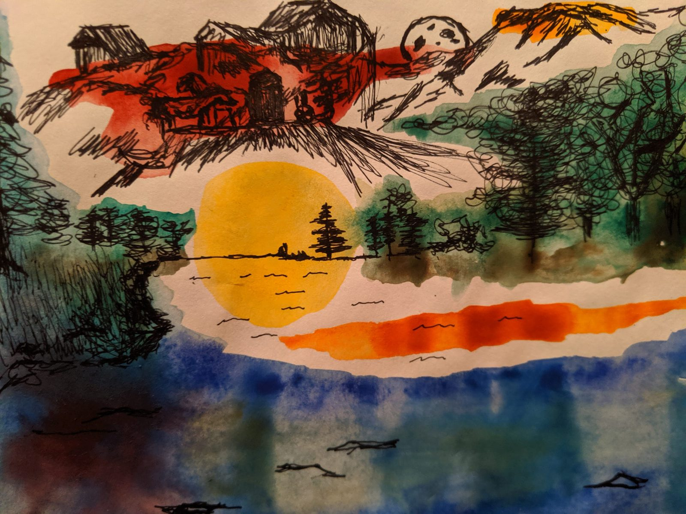

* * *

we are human now child of wonder
in all our glory gruesome nature
partners to ourselves
joined halfway behind the stars
loving one another

past the tempoed limits of existence
whole and broken-mirrored
hearts beating time together
wed woven in connection
on the path of life and death

never-not-broken moving dreamtime
liquid colored crystals dripping from our lips
reflecting violetmarmalade skies
in the land where suns will never rise
surrounded by dancing colored lights

until then

the sky is blue my love

And I am ALIVE!

bearing witness I sing
of how we materialize
in unimagined strangeness
flying lightly on dragonfly wings
built within the minds' eye

beyond the sunset
past the stabled moon
in starlight ships
wandering dreams
and hallowed spaces

bellowing out in the Halls
beside our swains and wenches
sharing tales so tall and daring
drinking heady ambrosia headlong
from the skulls of our dearest loves

dancing Gingerly down the stairs
like Fred was wont to do
gliding softly through
stages reflecting spotlights alum
between the veiled red velvet folds

running through the Field
twirling as we go
saddling light to limits unknown
as children of the Sun
playing tag with the West Wind
hide-and-seeking with his brothers

wearing rings upon our fingers
so bright they flashblind us
crooning bells upon our toes
clapping out crying tears
pealing laughter riotous joy
languishing in anguished love

performing on a stage so bright
firm adamant castling as images
float aloft on pixeled wings
all draped in silver spiderweb
sharing ourselves full sundry
those travels and travails of life

making music of our senses
living new reliving all over and over again
experiencing ourselves in and out of love
drawing labyrinthine paths between
for all that hasn’t happened yet

we are small
and limited
now

but not as small
and limited
and strange

as we could be

we are large
and powerful aware

but not as we will be

we will learn

forget

and learn again

exploring the infinite
upon infinite dimensions of life
more than we could have imagined.
possibling the impossible

and more again

and then some

having read
the book of fortune
our lives and deaths
together

we exist to know the now
find ourselves and only
in what we choose to feel
fantasies and failures

along the rainbow bridge
streaming in
the fullest of friendships

making meaning in what is

what matters

and what matters naught

in living we die not
in dying we love not
in loving death is iterate
in death love is infinite

* * *

*201609*

* * *

*The paradox of happiness requires*
*we acknowledge suffering*

* * *

**seiðr**
Fólkvangr
Sessrúmnir
Valhǫll
