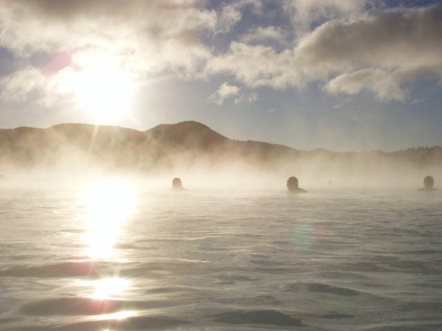

* * *

Early morning Fall-cold-wind
Puffing through the cracks
 in the motel window
Poached-egg and hot-potato breakfast

Careening down the highway
Dry desert, high mountains
Wide-open-blue-skies
Sun pouring through icy glass

A bouquet of burnt-orange leaves
Perfuming old bleached bones
Dragged from the road
By a wild scavenger

My own meaty bones
Boiling red in a lobster pot
Blanching in the cold bath
Sizzling swelter-stinging shivers

A sultry waterfall massage
A wintry spray of mist
Sweat in a sauna slipping into
A sigh-breath of mountain air
