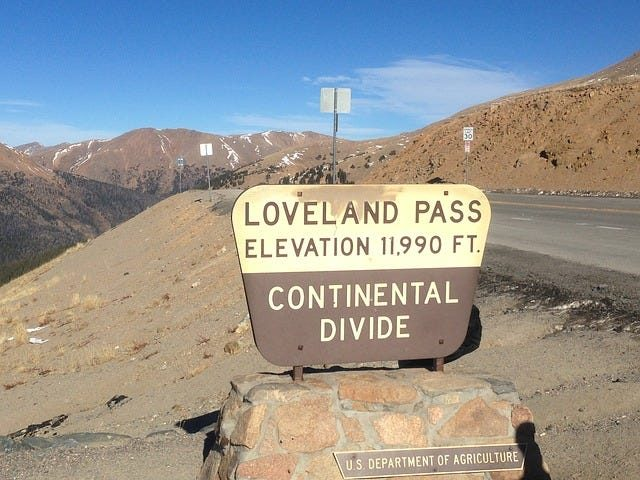

* * *

*Life is water, Time is money, And the glaciers are melting*

* * *

The Great Divide of the Americas
Separates the flow of water
Of one side from the other
The lay of the land dictates
The largest continuity
Guiding the flow of life
On each side of the snowpack,
Long before we arrived.
This divide created the watersheds,
That fill our coffers and our fields,
Thus guiding our evolution.
It defines where what is *drained*
And what is *dammed*
Can be used for Love
And Power
We have always been divided
Out of many, One
