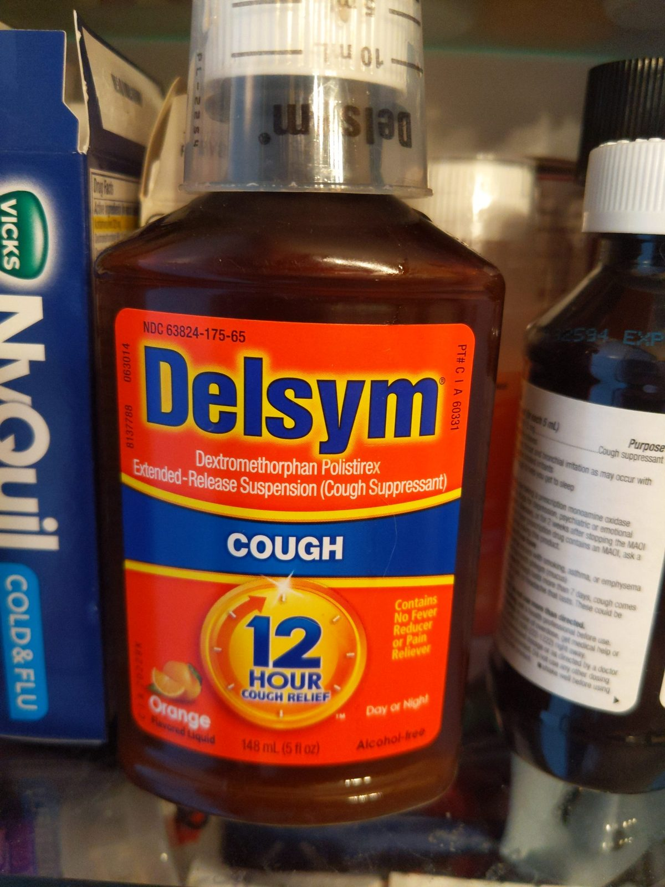

* * *

c
ca
cah
caw
crow
crowing
crowning
coughing
corona
COVID-19 coughing crows on the radio
daylight awakens alone again
glory to the new world order
praise to the working stiff
zooming in a roomy rumi room
alone together transcendent
quiet nights alone again
owls who owe hoot hoot hooting
owls
who
howl
how
ow!

* * *

20200403
