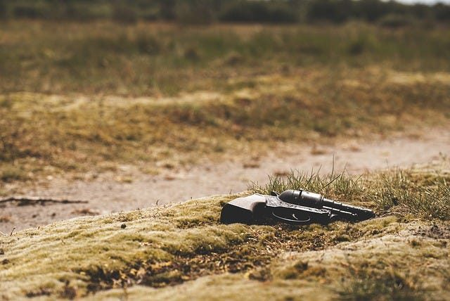

* * *

The dinner bell sounds.

Slick, gray-skinned men

Angry and unkempt

The suit of their trade

Dead eyes shining, begin

Filing in from the lobbies

Of the corporate hotels,

Inside gilded banquet halls

Eating together,

Allied in anonymity

Pecking at the food and

Checking their feed.

Silently, crafting plans to

Corral the innocent and

Rustle pent-up demons.

Manifestos and proclamations

Yodel in echoed canyons

Read between the lines

With such similar effect in

Lassoing the stolen trust,

Entitlements, and loneliness

That come roaring through

The landscapes of their minds

Having had their fill

They file out in intervals

Going back to their rooms

The roundup sounds on the T.V.

They stand, guns in hand

Connecting with force and

Angling in a singular shootout

At their own high noon

Near the O.K. Corral
