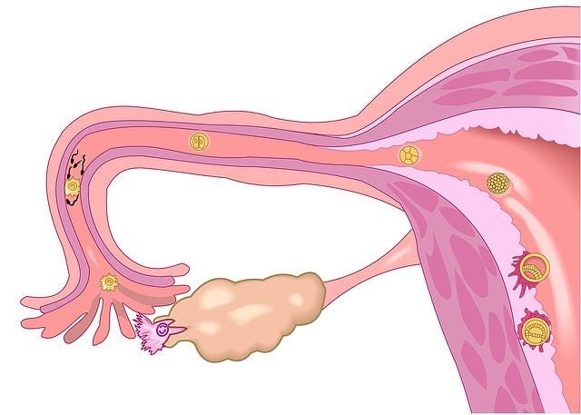

*[https://pixabay.com/en/users/heblo-1758675/](https://pixabay.com/en/users/heblo-1758675/)*

* * *

The cancer spreads outward
From the root of all things
The uterus, creator of my universe
Leaded poison trapped inside
Expansive tendrils of fibrous webs
To seek would mean to be acknowledged
To admit and understand something that
Has been cloistered and ignored
And still frightens mankind

Bleeding and hidden, a stage behind *meat curtains
*Our volumes exist without a voice
Those femmes with, and those without
Our bodies a facade
So many can’t hearken,
Viewed with suspicion and fear.
It makes no sense beyond that we
Are other, removed, excised
Whatever historical frameworks that exist
Have acted, silencing the statements,
What concerns us,
The feminine concerns — are harder to hear.

The power structures that are in place,
In every walk of life, were built before
We were anything but slaves and property
Penetrated like an enemy fortress,
Part of the land, a plot of dirt,
To be fertilized by the plow
To be rendered and controlled,
Tended until barren and childlike *hysterical
*But “*funbags*,” oh they get objectified attention,
With products and pink ribbons
Like Mary’s glamour 
Shot by all the unnamed mothers
There is no I in Uterus
But, hey, there’s an Oo in *boobs*

And the times, they are a changin’
Even while the cancer grows
