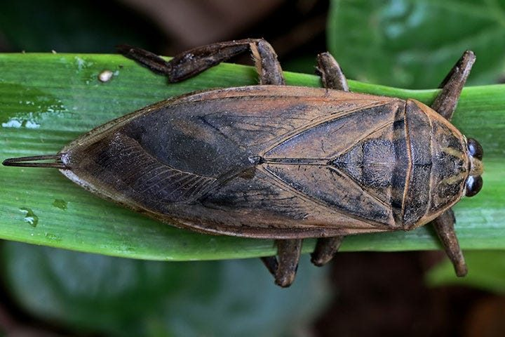
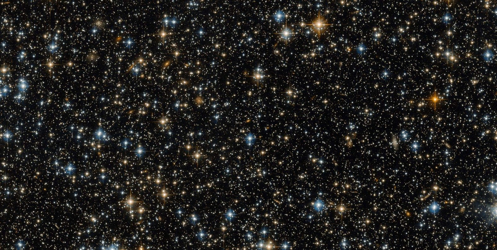

The heart of an insect once beat so

Quickly in an untouched jungle

Riding lightly on the back of

A distant island

Out where the waters deep

Ran warm and clean,

Brimming, frothed with life

And cold, so cold, below

A brief bite of crust

Cooked warm

Inside a molten-solid core

Beyond and back again

The surface tension holds

A taste of atmosphere

Around a muddy, wet

Blue droplet

Inhabiting a vacuum

That basks with the glow

Of a burning speck of dust

In a slowly swirling

Hub of radiation,

One of many

Yawning mouths

In a rambling-rumbling ocean

Of brightly flickering sparks

