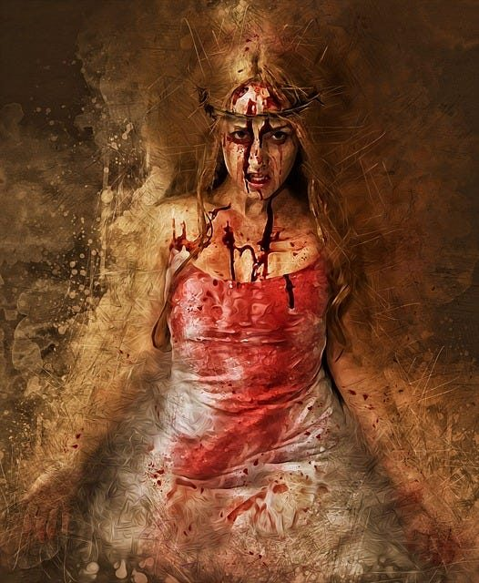

*[darksouls1](https://pixabay.com/en/users/darksouls1-2189876/)*

* * *

Demon/Goddess I am Not.

Human flawed and flailing, Yes.

Jerking that jerked the jerker

The knife ripped wide-open,

Flayed and fragile.

On display upon the altar

Diced and sliced to the nth degree

Bloodletting a sacrifice

To the pain and numbness

Caused by the worship of false idols
