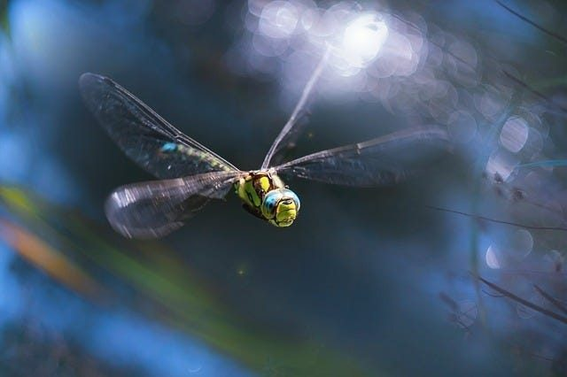

*[*https://pixabay.com/en/users/Lepale-3791844/*](https://pixabay.com/en/users/Lepale-3791844/)*

* * *

Magic is not realizing
You feel the flight touch of butterfly kisses
Flickering across your cheek, your neck, flowing down your vertebrae

* * *

Magic is not singing
Through the silence found in reverb
A Sama-spinning dervish, a silent intake chanting slowly outward

* * *

Magic is not caged
Light glinting off the raindrops
Glowing gems of dragonfly wing rainbows, making clouds inside your eye

* * *

Magic is not finding
The crystal-clear night sky, the swirling Milky Way
Leading you back to your place within the world, a brief speck in a vast universe

* * *

### ∞ ≈ 1 / 0
