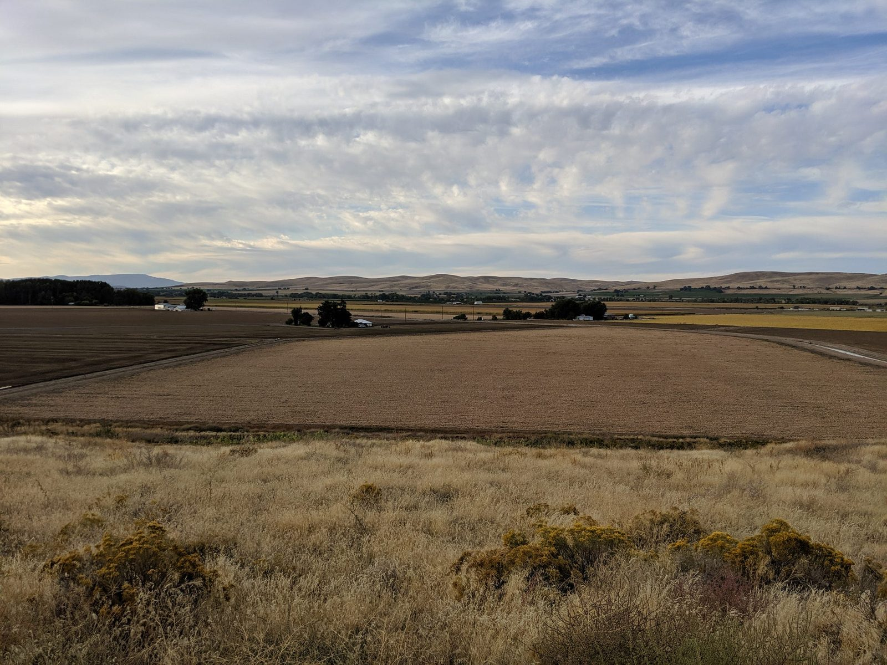

* * *

At first its Pink leaves fluttering
In the backdraft of the road
White crescents rolling, strewn across
More pink. What kind of leaves are those?
And then I realize
From the smell--Onions!
Rolling ruined along the road.
Onions? Really?
And a box of potatoes! Left abandoned. Food so plentiful
That it’s literally dumping off the truck
My God! A caravan of giant trucks… filled with onions.
Driving slowly down the highway.
Black-haired men and women with rainbow sunglasses inside each one.
They smile and look concerned about the onions on their radios.
Next to a Model-T being towed by a white-haired old man with a confederate flag on the back of his black Dodge Cummins.
I’m afraid of the onions and what they might do.

* * *

*201909*
[*https://youtu.be/WXE1qS17G2c*](https://youtu.be/WXE1qS17G2c)
