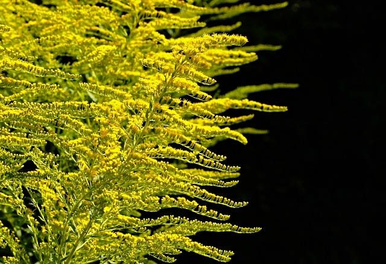

*[https://pixabay.com/en/users/manfredrichter-4055600/](https://pixabay.com/en/users/manfredrichter-4055600/)*

* * *

Questions are a gift

From the eternal why

An intake of surprise

Answers are the pulse

The burst of life, words

Which lead to more questions
