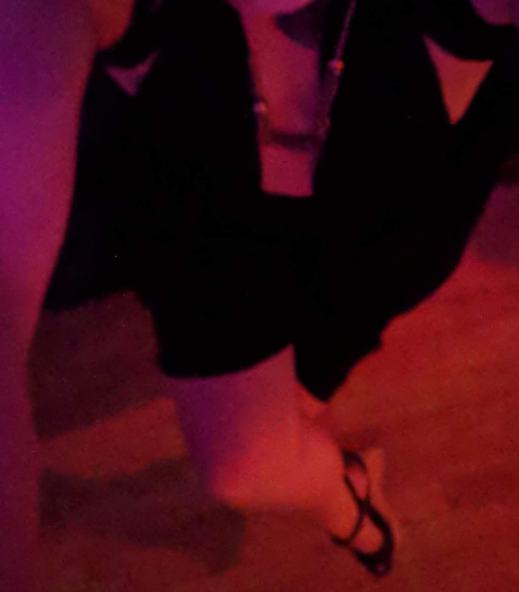

* * *

Black silk
Drifts up her thighs
Slinks slowly upward
To reveal lace
Obscuring the cunt
That you've been aching for
And imagining
How it feels
Imagining
Smooooothhh
Ness
The supple taste
Imagining
Slipping your tongue
Slowly between
Her labia
Looping around the edges
Searching around
Up and down
Around again
For the tip of the clit
And then sucking
Slowly tasting
Smelling the savory-sweet scent
Imagining
Her moan and shake
With pleasure
As she grips your hand
Bites her lip
And pulls your hair
You mouth, your lips
Vibrating
Tongue aching
With desire
The cold intakes of breath
The cozy moist warmth
Getting lost there
Waking from reverent revery to
Find your way back to reality
The nightie barely catching
On the tiny black bow
Of her underwear
Still sitting a few inches
Below her belly
As the gown rises further
You glance into
Her smiling eyes
Feel your heart melt
Like warm chocolate
In the sun
Your eyes briefly close
In awe
In contentment
In joy
An ache in your heart
And your groin
Grips you
As you lay puddling
You can smell musk
In the air
She pauses
Waiting
Taking in the sight of you
The scent of you
Into her body
She licks her lips
And smiles slowly
In anticipation
Her fingers continue
To gather the gown
Rising past her darling
Belly button
Her ribs
Her nipples
Hard
Poking and catching
Beneath the silk
And you imagine how
They feel in your mouth
Bouncing off your tongue
Buoyant, even more
From your attention
Salivating
Just thinking about it
As the nightie is gathered
Lifted over her head
And flung with a grin
You take in the glory
That is this woman
Your partner
Your lover
You reach for her
Pull her close
Feel the muscles moving
Beneath her skin
The tender softness
Around her hips
As you slip
Your hand inside
Her underwear
Feel the soaking wet
Crotch stick
As you slowly pull them off
Looking up
Caress her face
Gently kiss and nibble
The supplest lips
You ever felt
Like warm ripe fruit
You feel her gaze
Reciprocating
Your focus
Gently consuming
Every bit of substance
And returning
Idem Potentency
Appreciating
Every bit of glory
In each other
As you give and take
Worship
The essence
Of each self
Separate and
Within union
With a deep breath
A sigh
And a sharp intake
Of surprise
You enter each other
A feeling
Home
Warmth
Safety
Awe
Excitement
Desire
Gratitude
So much electricity!
Plugging you in
Helping you grow
To feel
To explore
The edges of you
The space inside her
Pushing and pulling
Growing and changing
Coursing through
Creating a vacuum
Of empty space
To be filled and felt
Sparks fly
Where she touches you
Grips you in ways
You didn't think possible
Your body moves
To a rhythm
A frequency set
Long before you were born
In time with hers
She shivers
With sensation
You shake
With tension
Trading and teasing
Between one another
Space-time ripples
Opens to reveal
The secrets of the universe
The eternal now
Doors unlocked
To realms unfathomed
All Eyes Open
Waving awake
Alive again
Blinking atop
Your brow
Breathe
Into Being
Alight upon
Your crown
Shot from the root
Of your spine
And Coming to life
Inside your heart

* * *

082019
