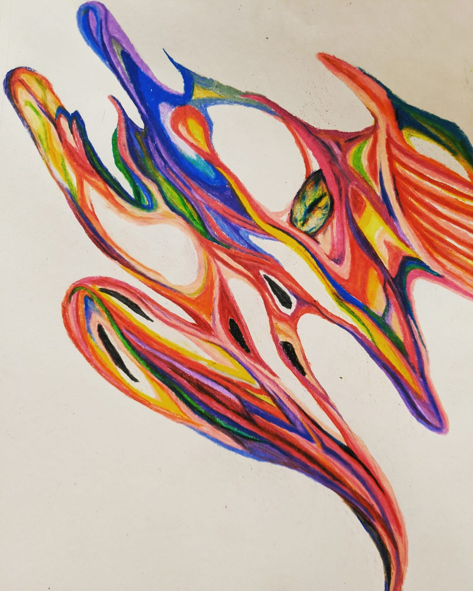

* * *

Dance

Dance

Dance

Dance

Dance

Dance until you are home
Fancy
Dance
Until you are home
Until you are home
Until you are home
Until you are home
My Love

Until you are hungry
Into your hurting
Stretching
Starving
Needing
Thirsty

Into your heart bearing
Beating
Thump
Thumps
Thinks
Strums
Strike
Strings
Staining
Stinking
Drinking
Swimming
Drumming
Strumming
You missed the starting gun
Fun

Hunting
Running
Holding

Letting Go

For your life
Your love

*I'm a fool for your pageantry
Tell me again
What's the allure of an
*Inconsequentialist morality?

* * *

*202010*
[https://youtu.be/-TcUvXzgwMY](https://youtu.be/-TcUvXzgwMY)
