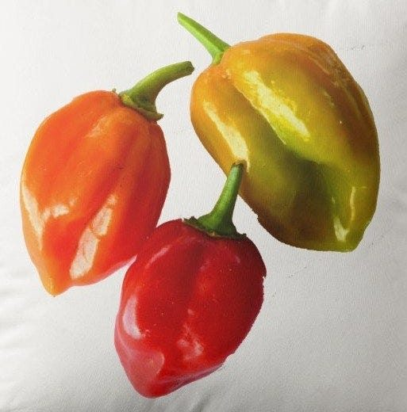

So while i was traveling to upstate New York, my friend (and ride) and I stopped at a little Jamaican place called “Maroon Girl” in Fishkill for lunch. It was obviously recently opened, and totally the real deal as far as mom and pop shops go. The proprietors were lovely people.

i asked if they had any scotch bonnet peppers because i’ve had a hard time finding them in Utah.

And the beautiful woman looked at me and said “of course” with her earthy voice and trotted back to the kitchen, came back with three delicate peppers gently wrapped like treasure in a napkin.

i stuffed them in my sunglasses case and transported them all the way to the [Chapel of Sacred Mirrors (CoSM)](https://www.cosm.org/) where I met my initiate friends from the mystery school. I can’t talk about what happened after we left the chapel. I took a vow, but in part because I have no words that would describe it.

On the train home I gave the red one to a new artist/architect friend that I met at the school.

* * *

I just now cooked one upon my return. The flavor of the scotch bonnet is akin to habanero, but also not. Rounder, deeper, gentler.

They are gifts. They are magic. They are beautiful. They taste like a lost soul coming home to beloved family, like walking down a tree-lined path in sunshine. My lips tingle and pulsate with life and the blood that runs through them.

I’m saving the seeds and will plant them.
I will have scotch bonnets whenever I like.

I will be reminded of how food gifted and kindly given tastes better. It will remind of one of the most profound and lovely weekends of my life — of new and old friends and of the meaning and magic the first time I tasted of this life. Of the gifts I’ve received and of the first time I cooked these gems for myself.

* * *

Here’s the poem called *The Maroon Girl* by Walter Adolphe Roberts:

I see her on a lonely forest track,
 — Her level brows made salient by the sheen
 — Of flesh the hue of cinnamon. The clean
Blood of the hunted, vanished Arawak
Flows in her veins with blood of white and black.
 — Maternal, noble-breasted is her mien;
 — She is a peasant, yet she is a queen.
She is Jamaica poised against attack.

Her woods are hung with orchids; the still flame
 — Of red hibiscus lights her path, and starred
 — With orange and coffee blossoms in her yard.
Fabulous, pitted mountains close the frame.
 — She stands on ground for which her fathers died;
 — Figure of savage beauty, figure of pride.

* * *

[https://www.yelp.com/biz/maroon-girl-jamaican-cuisine-fishkill](https://www.yelp.com/biz/maroon-girl-jamaican-cuisine-fishkill)
[https://www.cosm.org/](https://www.cosm.org/)
