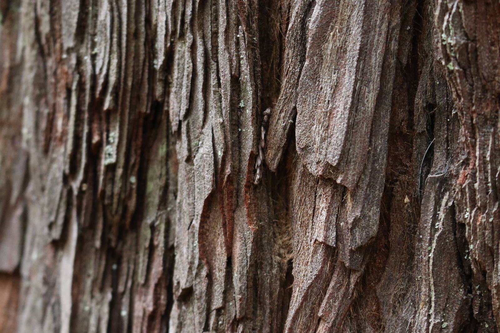

*breathe it in slowly*

* * *

the bark runs

roughly up

fingers splinter

supple amber

sap wounds

needles softly drip

shadowed light plays

upon decay

exhales incense

in an earthy union

soil ripe with life

loaming roots

a gold green crown

within the grey blue sky

the canopy whispers

songs of fire rain wind

fractured patterns

fluttering dialects

chanting creaks

cycles of light

harvesting heat

cool dark perspiration

beads slowly streak

down the trunk

land on limbs

quivering below

undergrowth guards

the bottom-feeders

wormholes shifting

silt and sand

root and well-water

suckling soil

stream slowly

inward outward

toward the heart

surging through

each strong branch

each trembling twig

each soft leaflet

spreading over

eons of change

connected

to the all
