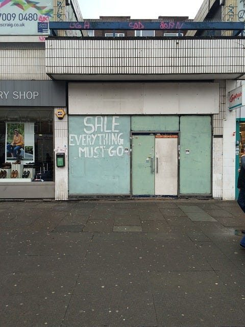

* * *

I’m closing up shop
Posting a sign saying
“Going Out of Business”
The till is empty
Because this place
Is too expensive
To run any more.
The gap between
The price it takes to
Stock the shelves,
For my time,
The bills go unpaid
The books aren’t balanced
I’ve made so many mistakes
With this business
It’s no longer a dream of mine
Rather, my needs were conditions
I signed with blood
I’ve paid with interest,
I paid and I’ve done wrong
For so long, so many times
I’ve paid with my body and soul
Because that was the deal I made
