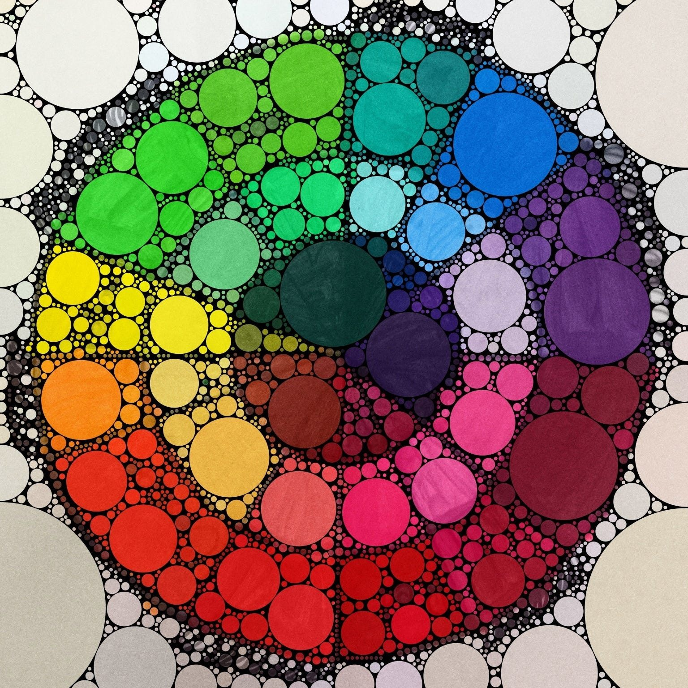

* * *

When life is full of greys
Oh that ache
That heartfelt ache — You
Never stay away for long.

* * *

You have been the arbiter
Of what is black and white,
Of what is right and wrong
But what right, and what wrong
When all you feel is grey?

* * *

Making meaning makes rainbows
You, dear pain, take on new hues
A childlike continuum of color,
A gradient expansion of possibility
Of character, feeling, and family. Purpose.

* * *

Blues dance with electric integrity
Greens a growing compassion
Yellows beam a warm acceptance
While Oranges’ gratitude bursts in
And Reds, oh Reds, you darlings
Fill a Moebius with Violet floral Love!

* * *

Our heart holds all that in it
Nuanced bias, once seen, acknowledged,
Those extremes in value, blacks and whites
Build grey’s stony abode for when
The colors come running through,
When we, dear heart, are perceived and
Welcomed home

* * *

*What principles do you hold dear?*
*What helps your heart expand?*
