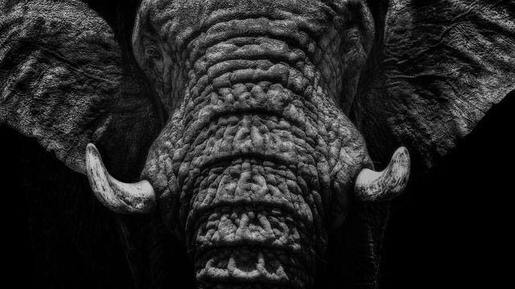

*[https://pixabay.com/en/users/IanZA-2026973/](https://pixabay.com/en/users/IanZA-2026973/)*

You showed up in my dreams

I looked at you and saw

Joy

Your hair was the same

As when I was small,

At the height of your strength

Golden-Red-Brown-Curly

Haloed

And, if you can imagine,

You were young and old

At the same moment

There were more wrinkles

Your wrinkles had wrinkles

That you could fall into

Deep and laughing, not delicate

Darker, brighter, stronger

When you smiled they multiplied

You’ve grown more beautiful

Your face glowed

Your skin glowed

The sun shown on your face

Made it golden.

And you’ve come to love the sun on your skin

You’ve grown so much more into You

I asked what death was like

You looked wryly around,

Like you were sharing a secret,

“Dear, honestly, nothing much changed”

And you grinned the biggest grin I’d ever seen

Surrounded by your friends, your family

A queen among them

* * *

Coordinating a party —

To express appreciation

We were, all-together

Dinner and an antiques auction

To support the arts, the children

Our history, and our future

And after that, a movie

The first one you saw

Black and white,

Showing all the hopes and dreams

In full-colored promise

Of America, Of equal rights, Of progress
