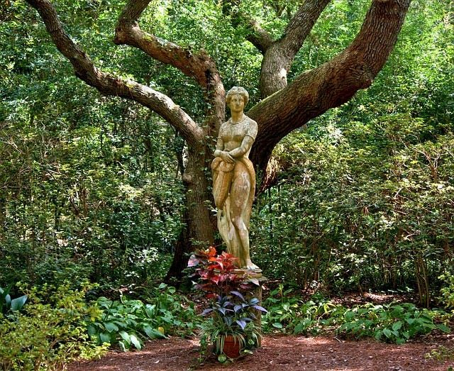

* * *

Arrayed in elegant satin of emerald green

Limned with gold and sparkling things

That purl like leaves on a waltzing willow

She moves confidently to your side

Whispers in your ear and,

Barely brushing your skin with supple-soft lips,

Pierces your roots with eyes like splintered bark

And whites, so bright your vision moons and wavers

She tells you what you’ve longed to hear

As the warmth of her breath whispers down your neck your spine

She grabs your hand, squeezes gently

And you shiver, tremble

Inside her earthen promise

Her call builds

A chorus of tiny crickets

The wind blown through aspen leaves

The rumble of the river running down the hill

And the howl of the pack, of the owl, under the night sky

Soaking into, bursting forth

Felled

In Love
