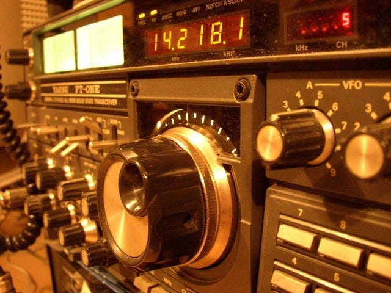

* * *

Lilting broadcasts burst in and out
An operator, hunched and listening
The transmission equalizes briefly
With a fluttering response
Beaming across the divide

CQCQCQ

Skipping waves across the distance
Transversions pile on and through
Input signals drift and hum resistance
Dialing up the receiver
Hunting the elusive vox

CQCQCQ

Scanning channels, squelching circuits
Birdies chirp away, voices sing their 88s
Amplitudes modulate in their carrier
Absorbing and reflecting
Hopping along the ionosphere
