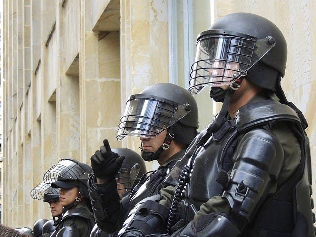

***9/11/2017***

* * *

* * *

Sounds like glass breaking
And the thud of clubs pounding plastic shields
As armored men walk in unison down the streets
The roaring rise of voices
Building from a murmur,
Charging, cresting
The sound of brass knuckles meeting flesh
And screams from a distance bouncing off
The corporate glass that mirrors
The events of the day
