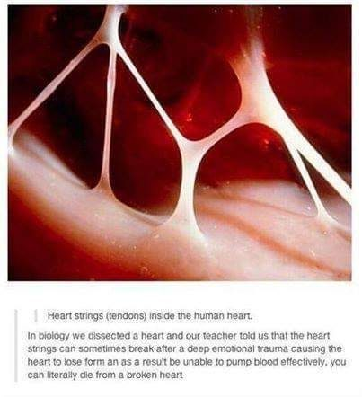

* * *

You played me like a bloody harp
With ichor on your fingers
My heart, it strums, to a different beat
Than what I've come to show you
I tried my best. It warn’t enough
To help me see your soul
I know I failed to look within
To find the darkness w-hole-ly.

* * *

*201703*

* * *

*Three times the charm*
