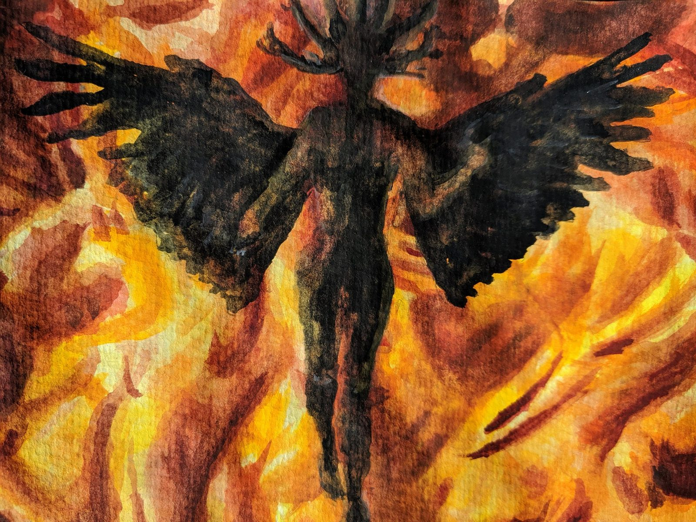

* * *

[https://youtu.be/gVlwPujkmLA](https://youtu.be/gVlwPujkmLA)

* * *

Each and every 
One of us
Houses Demons

* * *

Inside the Temple
Of our Mind
They Lie in Waiting

* * *

To be Wakened
In the Dark Times
Of our Insecurities

* * *

When challenged
Will rear up Screeching
Fly in Chaotic Formation

* * *

And do their Damnedest
To protect the Lies
The inflamed Fears

* * *

Left by the Wounds of childhood
That gave them Life and Purpose
As Guardians and Siren Mothers

* * *

And If you Sing to them
If you Look them in the Eyne
Name them Each

* * *

Directly
Soothe the
Searing wounds

* * *

That they
As ashen Angels do
Protect

* * *

They’ll stop their Batting
Calm
And Come to you

* * *

Settle on the temple Floor
Where the fire Rises between
The Cracks in the firmament

* * *

While you wipe Clean
The Marks upon their Brow
They might bite and sting, Arguing

* * *

But maybe, eventually, Yet
They’ll Listen
For they see All through

* * *

Distorted and disfigured Lenses
It might take Time
Life’s Eternity

* * *

To become their Priestess
Preaching
Cross-legged on the floor

* * *

For they will Always
Guard those flames
Like Hestia

* * *

At her Hearth — still
If you are Able to
Heal the Wounds

* * *

Be handy Enough to
Repair the 
Columned floor

* * *

Contain the Flames
Of Passion Pain and Fear
Pay Obeisance

* * *

Where Worshippers
Of your House
Yourself

* * *

Will Come
Be Well Come!
By Your acolytes in white,

* * *

Now guised in Winged Strength
The flames of Passion
Devotion Tamed

* * *

Residing in their Mien
Branded by memory
Raised and cleansed by Song

* * *

*And let this be our prayer
To the Pantheon of gods and saints
Demons, angels, holy ghosts
Prophets and their flock
 that reside within*

*Hail Satan, See our pain
Praise Allah, Bow substrate
Cry Jesus, buddha, gentle guide
Name Brahmin, Yahweh, Shiva, all…
See us shine through clay
Do unto us as Others
As Thou Wilt In Holy Choice
As above and So below
Joined and fully Whole*

* * *

06/03/2019

* * *

How can I live without you, how forgo
Thy sweet converse and love so dearly joined,
To live again in these wild woods forlorn?
Should God create another Eve, and I
Another rib afford, yet loss of thee
Would never from my heart.
 *— Adam, Paradise Lost, John Milton*

* * *

[https://open.spotify.com/track/0rVE6NMbmthAKmErBhvf9e?si=bcq9HD6CRi2aL61E-xmArA](https://open.spotify.com/track/0rVE6NMbmthAKmErBhvf9e?si=bcq9HD6CRi2aL61E-xmArA)
