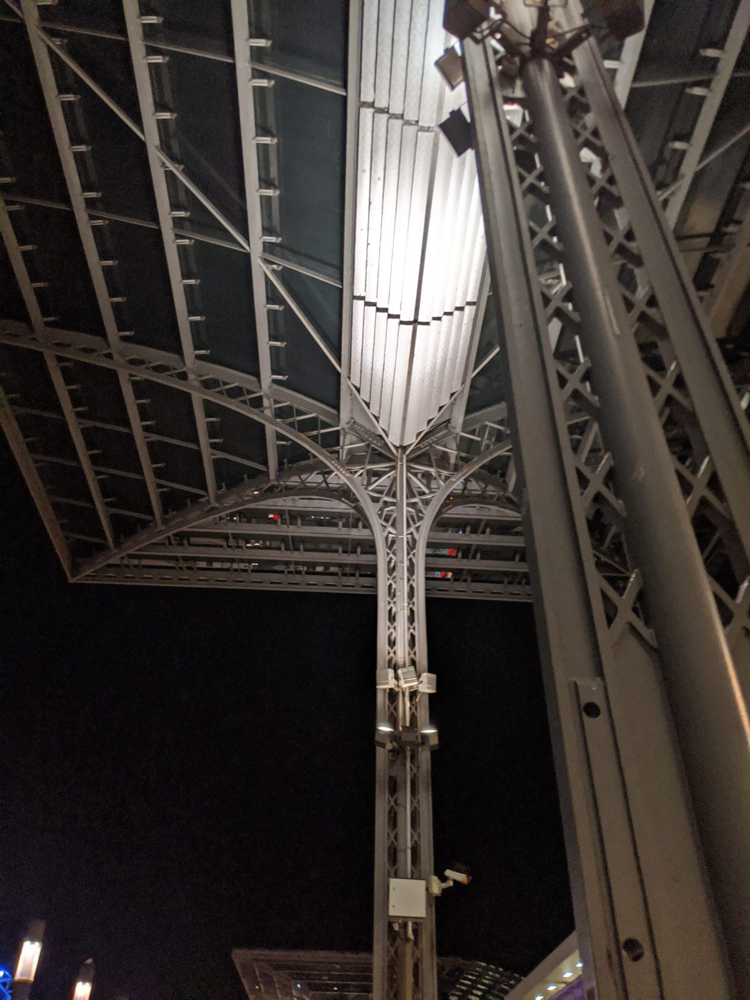

* * *

a man from haiti
a refugee in a foreign land
he now calls home
sitting in a train station
sees someone
a foreign woman
queen he says
waiting
like him, but not
intriguing
attracted
a brightly colored suitcase
sits nearby
entranced
confused
she’s not been here
but she remembers
this moment
is familiar
a crossroads
the backside
of a cathedral
built over centuries
black with age
takes her breath
and turns it to tears
of wonder
for humanity
for what led her
here
as she walks
the causeway
across the rhine
covered
in lovers locks
looking back
moving forward
refuged

* * *

202008
