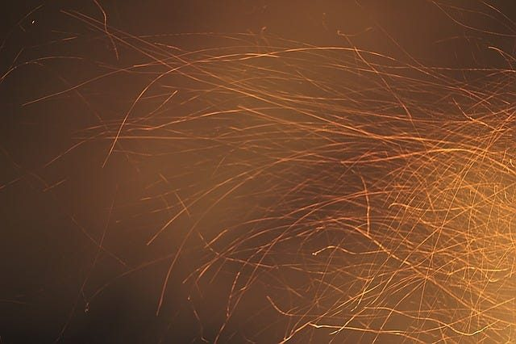

* * *

U can be my anger
I can be your tears

I can be your earth
U can be my stars

U can be my wind
I can be your clouds

I can be your science
U can be my …
… sparks

WE can be the idols
Of our clear-cut communion
