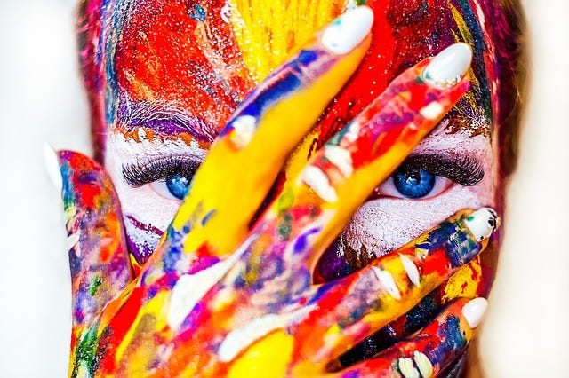

*[*https://pixabay.com/en/users/ivanovgood-1982503/*](https://pixabay.com/en/users/ivanovgood-1982503/)*

* * *

Between the sound of a laugh

And the slap of a clap

Between the birth of a tear

Straddling wavelengths of light

You’ll see me

On the back-side of your tongue

Where those bitter lemons meet

A taste you can’t find

I’ll bite

Like lightning through water

A thought escaping your mind

Now floating around

You’ll find me

Chasing the purr of an amp

Below the step of your dance

Where we’ll slip into trance

I’ll hide there

When your eyes start to roll and

You smile in the corner

On the dark side of your lip

I’ll catch you
