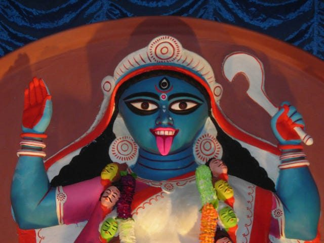

* * *

I want to fuck you so hard you cry
I want to rape you like you’ve raped us
I want to hurt you like you’ve hurt us

I want to take your un-shed tears 
And turn them into my bleeding rage

And then I want to burn the world
And drain your veins bone dry
And lick this rot sterile-clean

Your shit is death
Your breath is death
Your bile is death

You manufacture death

You stop the rivers
You churn the oceans
You drain the swamps
You poison farm and field

You kill my children

Your desire to be the life-giver
To turn the world on its head
Your unmitigated growth
Has created cancer

Halahala

Bring the fire
Bring the wind
Bring death upon us

I will dance upon your grave

And when I fall
From my tears streams will flow
Decay will bring new life
From our hearts green will spring

Life

Without us
Will go on

Death

Will plant our seeds
What’s left can flourish
And then I’ll drink

Breathe Deep

* * *

[https://www.demilked.com/environment-yin-yang-bring-back-balance-greenpeace-mccann-worldgroup-india/](https://www.demilked.com/environment-yin-yang-bring-back-balance-greenpeace-mccann-worldgroup-india/)
