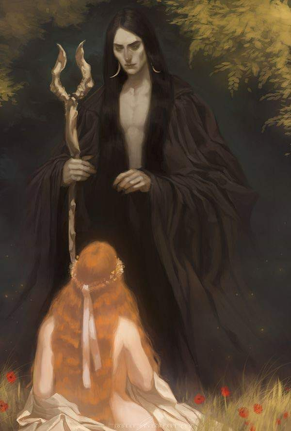
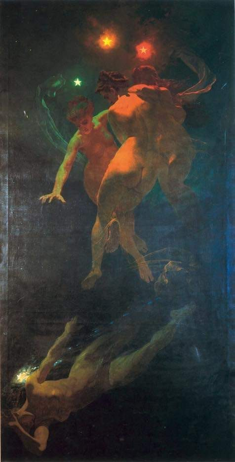

* * *

darkest Saturn calls
from the Underworld
Winter’s back,
turned away
cross the Styx
slough
fall
dive deep
down below
further now
un-fathomed
dead memories
Spring-Time answers
life-sustaining
two bright lights
dimmed
by the matte black river
a third lay flickering
projected silver reflecting
Nothing
drowned in rancid waters
neglected far and long
returning Home
left the dank
the deathly mire
emerge submerged
impervious
our Achilles Heel
our broken nose
upon the stovetop
congealed
gushing blood
and goji berries
near the hearth floor
cleaned and razed
bruised and beaten
defeated keening
upon the Salmon shag
stained twice-black and more
ripped-out
thrown out
abandoned and discarded
haunted
haunting
my deader-half
resides there still
in the frigid basement
in the ashy white of winter
in the cold clear night
from beneath the earth
Howling
at the wild wolf moon

* * *

*202001*
*A tomb, a temple, a gravestone marked*
*Such crumbling stone, marbled whorls*
*Etched above and carved thumb-deep*
*Hades-Demeter-Persephone*
*The threefold corded path*
*The love once shared*
*Amongst each god*
*Broken and forgot*

