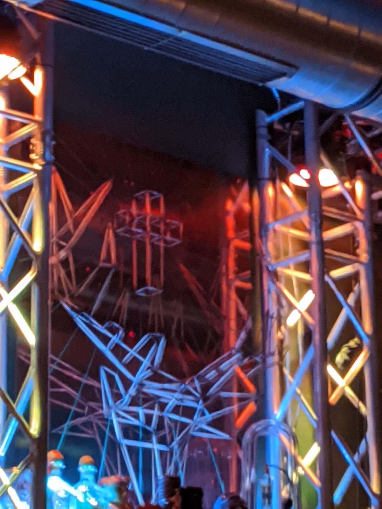
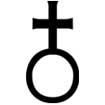

*Talking my way into a Kinky Dance Party under the Dome of the Cathedral, Koln Germany pre-covid 2020*

* * *

‘round and around
the mobius strip we go
i swear it’s better than living
as a mote of dust
floating lost in the infinite
awareness within that existence
felt interminable
maybe that’s just
my point of view in the now
a limited awareness
time-boundedness mattering
in the present moment
we each contain a vast abyss
bunny hopping those waves
a cross a crucible
a globus cruciger
our beating hearts
holding life by the bell edge
by hook and by crook’ed
wending along the fool’s journey
climbing through our tree of life
march forth
into the wild unknown
joy

* * *

*03042024*

