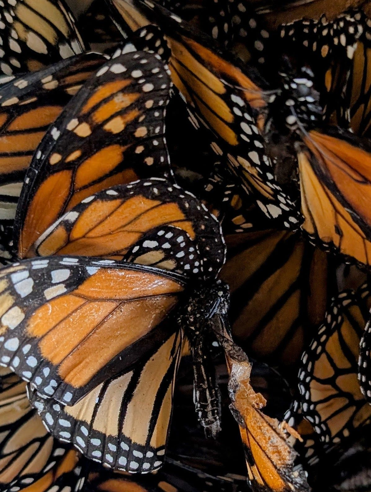

*“Much of life hinges on undeserved kindness” — JD Carlston*

*Fall Equinox, Buffalo Gap West Viriginia*

May all beings be happy and safe
May all beings live with ease
Be Free At Peace In Love
Whoever they are
Weak or strong
Large medium or small
Seen or unseen
Near or far
Born or to be born
Astral or material
Let what comes Be
For the good of all
And the harm of none
May all beings rest in joy
Spreading upward through the skies
And downward through the depths
Outward and unbounded
Freed from hatred and ill-will
Comforted and beloved
Hearts-held in fullness of being and becoming

* * *

*10042025*

* * *

## Karaniya Metta Sutta

*“Namo tassa bhagavato arahato sammā-sambuddhassa”*

This is a Metta meditation I’m adapting and memorizing. Its based on the translation of the chant Buddha gave to his monks after using Metta to appeal to the guardian forest spirits to stop a [rampaging elephant](https://kidsgraphy.com/the-buddha-and-the-angry-elephant-2/).

The [Emerald podcast](https://www.themythicbody.com/podcast/) reminded me of the story and I [found](https://theconversation.com/what-the-world-can-learn-from-the-buddhist-concept-loving-kindness-171354) a translation of the and started trying to put it into my own words.

I know its likely much more powerful in [Pali](https://www.accesstoinsight.org/tipitaka/index.html) because of how that language works, but that language is also not directly branched from my genetic spiritual line.

* * *

*Sakko ujū ca sūjū ca,
 Suvaco c’assa mudu anatimānī.*

*Santussako ca subharo ca,
 Appakicco ca sallahukavutti,
 Santindriyo ca nipako ca,
 Appagabbho kulesu ananugiddho.*

*Na ca khuddaṃ samācare kiñci,
 Yen’viññū pare upavadeyyuṃ.
 Sukhino vā khemino hontu,
 Sabbe sattā bhavantu sukhitattā.*

*Ye keci pāṇabhūt’atthi,
 Tasā vā thāvarā vā anavasesā,
 Dīghā vā ye mahantā vā,
 Majjhimā rassakā aṇukathūlā.*

*Diṭṭhā vā ye ca adiṭṭhā,
 Ye ca dūre vasanti avidūre,
 Bhūtā vā sambhavesī vā,
 Sabbe sattā bhavantu sukhitattā.*

*Na paro paraṃ nikubbetha,
 Nātimaññetha katthaci naṃ kañci,
 Byārosanā paṭighasaññā,
 Nāññamaññassa dukkham-iccheyya.*

*Mātā yathā niyaṃ puttaṃ,
 Āyusā eka-puttam-anurakkhe,
 Evam’pi sabbabhūtesu,
 Mānasaṃ bhāvaye aparimāṇaṃ.*

*Mettañca sabbalokasmiṃ,
 Mānasaṃ bhāvaye aparimāṇaṃ,
 Uddhaṃ adho ca tiriyañca,
 Asambādhaṃ averaṃ asapattaṃ.*

*Tiṭṭhaṃ caraṃ nisinno vā,
 Sayāno yāvat’assa vigatamiddho,
 Etaṃ satiṃ adhiṭṭheyya,
 Brahmametaṃ vihāram-idhamāhu.*

*Diṭṭhiñca anupagamma,
 Sīlavā dassanena sampanno,
 Kāmesu vineyya gedhaṃ,
 Na hi jātu gabbhaseyyaṃ punar-eti.*
