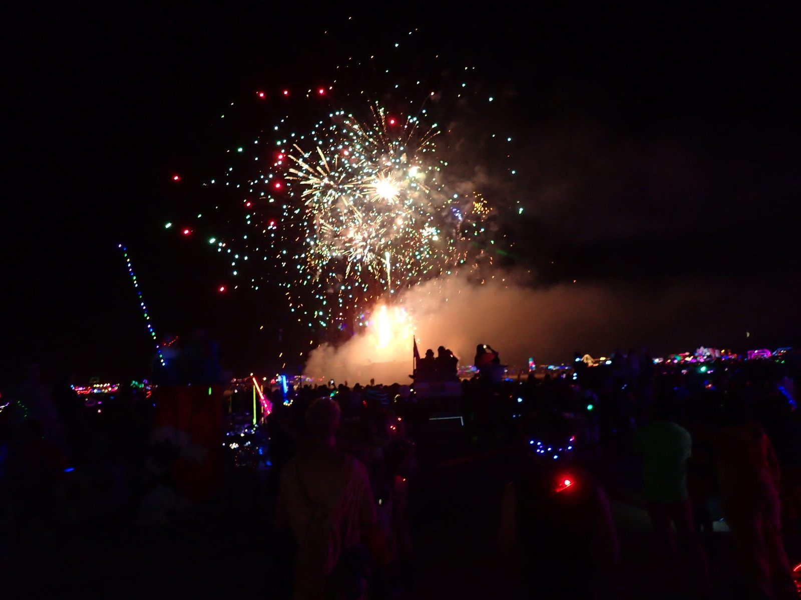

*A Tribute to Sappho’s Midnight and The Man*

* * *

It is Midnight
Pleiades cycle
Down below

* * *

Harvey cries
Calls for toilet paper
From that great porto in the sky

* * *

Red moon rises
Another orb rides
A lunar kite

* * *

A third of silver
Hoisted heavy, ballooned
Above the desert

* * *

Turns ‘round its Face Again
Orion dances, into the fire
Dove Invert, Reverse Swan

* * *

With the blaze
Fireworks blasted
Tuned and timed

* * *

Boom and flux of lovers laugh
Friends circling sound and light
Drones swarm a slow dance

* * *

In Nighttime dusty darkness
Between flaming embers
Of the Fallen Man

* * *

*09/2018*

* * *

The moon and the Pleiades have set,
it is midnight, 
and the time is passing,
but I sleep alone.

— *Sappho, Midnight*
