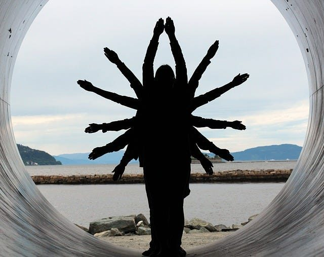

* * *

Your fingers so black
They reflect the starlight
As they caress my face
While I lie quivering
Sleepless, panting,
Awake, alive

Your eyes so green
They’re almost yellow
Laughing with compassion,
Piercing me with power,
And hidden tales that
You are waiting to tell me,
Secret and lonely.

I worship your soft belly,
Much like my own
Rippling and rolling,
Scarred from birth
As I hold you close
Shake with tears

You chuckle kindly
Pull me closer
Into your pillow-soft breast,
Warm as honey
You believe in me
When no one else does.

You tell me that I am loved,
Safe and at home
Your heart beats strongly
Through its cracks
With a purpose,
In time with mine

For you are always near
And whether I conjured you,
Or you conjured me
It doesn’t really matter
When we are alone
