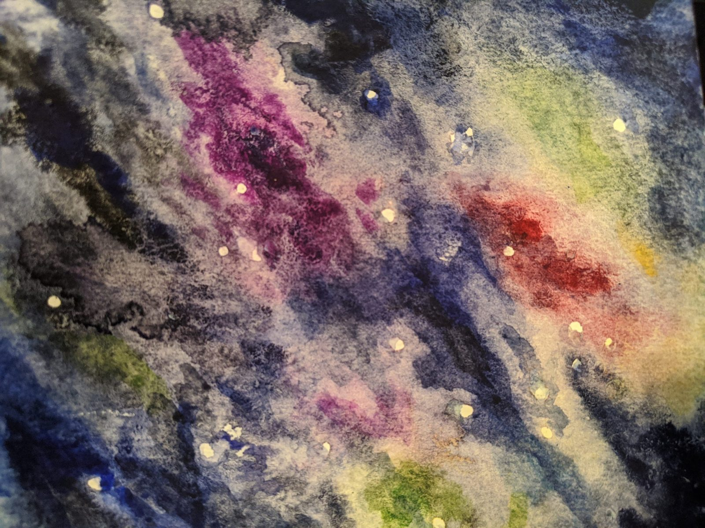
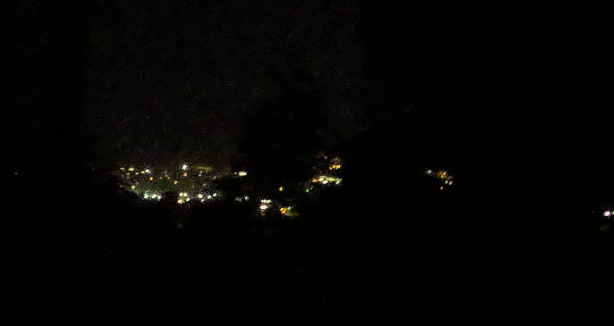

* * *

Tonight
grasp and hold
The Sacred
Tools
my.Practice
pres\*(ci)ent Murals
Streaming Sock( i|e)t to me
in darkness da(r&&m)(+n)ed
For(soo=>in tru)th myself
goddless crickets /\\<>{}
Fleet and flawed /\\<>{} /\\<>{}
clawed song /\\<>{} /\\<>{} /\\<>{}
humming
enjoy bea(dt)ed
silence
betw(een||ixt)
emptiness
within a golden b(owl?=>ough)++
held wooden
in side loose hands
!(Un)\*done with you
This! m.BoDied

* * *

*8/31/2019*

*The Sibyl, with frenzied mouth uttering things not to be laughed at, unadorned and unperfumed, yet reaches to a thousand years with her voice by aid of the god.*

*— Heraclitus*
