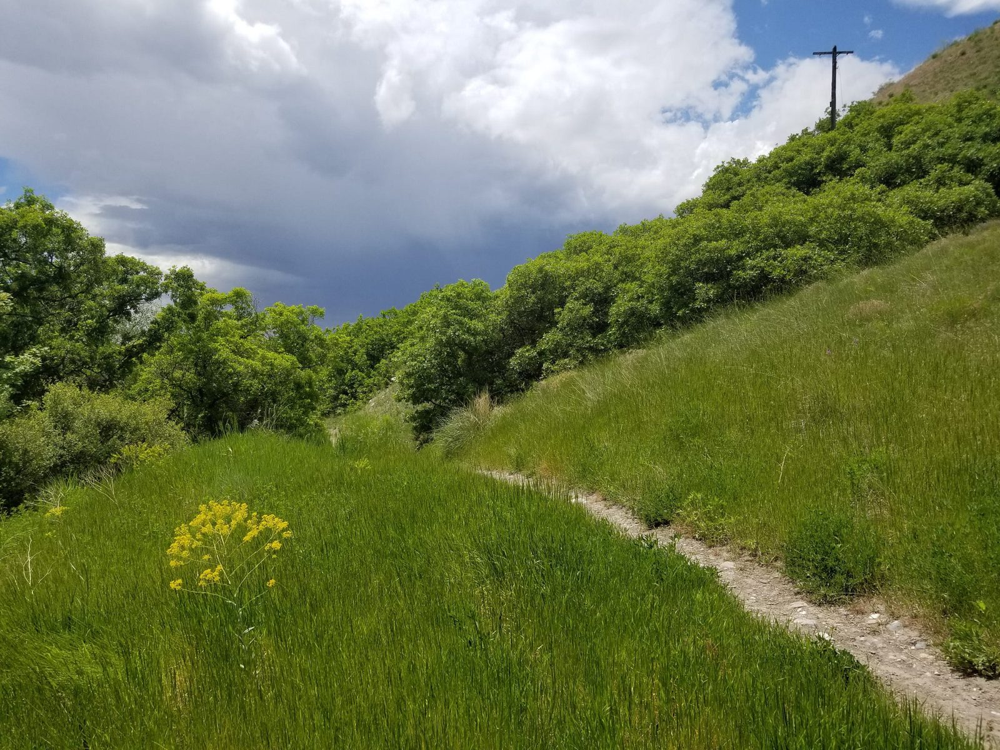
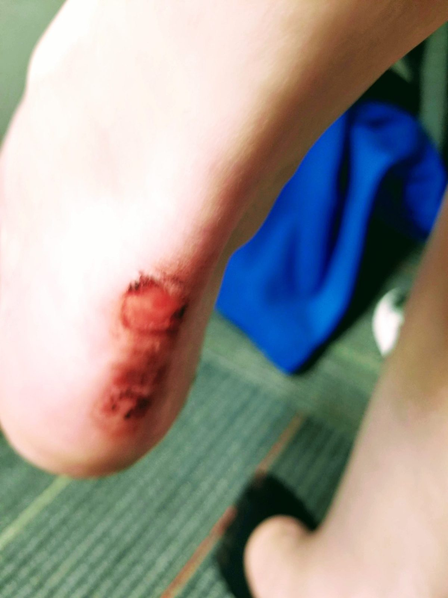

* * *

A Trans Sandwich Angel
Who’s beauty surprised me when I looked up
To give them my order at the window
“So Pretty!” I thought. Flustrd and entranced
“So Cute” came out instead.
Waiting on the bench for vegan sandwiches
Trying for a bit more loving impact
Kissing you, feeling the vibration between us
Near the Capitol and City Creek
Walking the road from our first date
All the way up in the almost-to0-hot sun
Wearing my new brocade-shiny shoes
To the bottle-opener bench
Where the furry-flying buggas hovered
Capturing our impressions in their faceted eyes
The purple Irises grew up, among others
And the wind ran down the hillside
Where we caught a private moment
Connecting in the forest of snail shells
All the surroundings hit us in a perfect symphony
Raining down on us
I’ve got the world by the tail
And the answers to life, the universe, and everything
Including bleeding heels
On my 42nd birthday

* * *

*05/2018*

