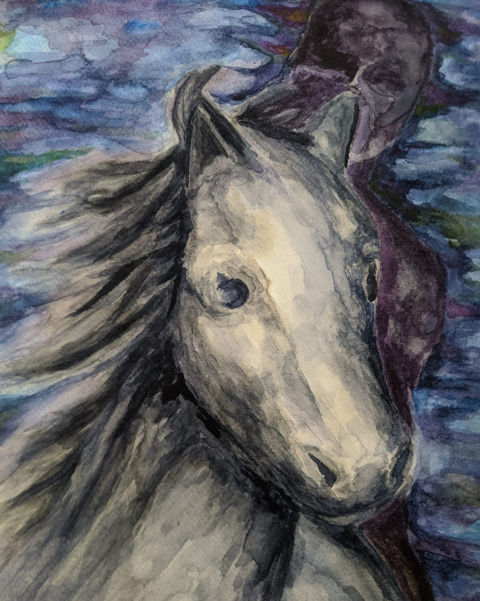

* * *

you are the 'night
riding the moon
grown full
stabled and steady
from before time began

* * *

racing along the milky way
with your starry cloak
billowing out
behind you
between cumulo clouds

* * *

the forest tips its top hat
bows in greeting as you
gallop swiftly past
soughing softly
whispered lullabies

* * *

the mountains face you
flaming gold and pink
lit by your hand in
darkest purple hues

* * *

the waves withdraw
crashing upon your wake
white-tipped
stirred up
and sputtering spray

* * *

followed by your
spectral swarm
waking woken souls
with candles dimly lit
inside their second sleep

* * *

calling all to heel
to lay a heavy lid
groaning mumbling
fall in worship
wound beneath your feet

* * *

*202007*
