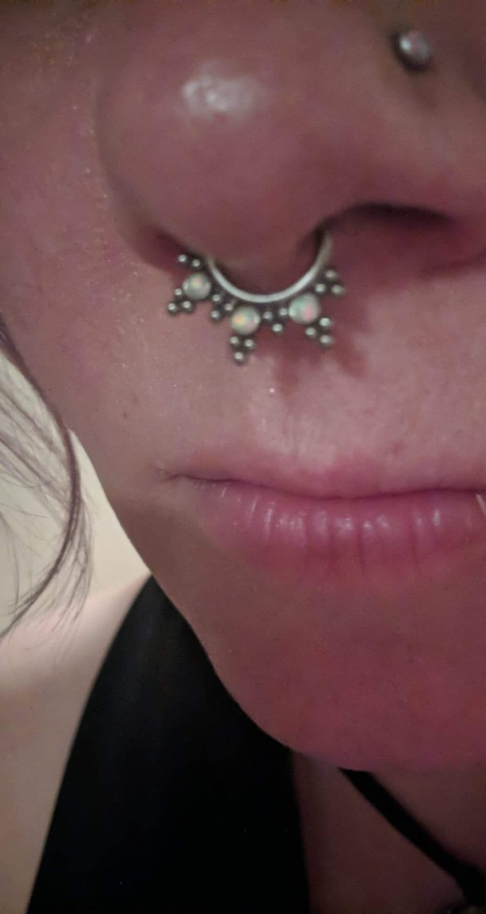

* * *

We deserve to be noticed
Even when we can’t speak
For ourselves

* * *

When we’re sick and hurting
We deserve to be treated well
With care *and* with empathy

* * *

The bees should be buzzing
The landscape is calling
To be seen

* * *

To be heard
To have the assumptions move
A strong and gentle love

* * *

Be one that notices
Wants to be and be better
Seen and understood

* * *

Look for the hurts
Freely and roaming
Not locked away

* * *

Aware of the power
Aware of themselves
Safe and secure

* * *

*06/2018*
