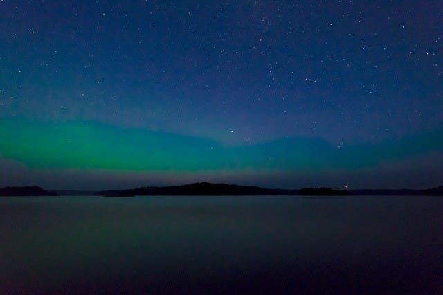

* * *

You are the North Star
I am guided by your light

I see your celestial body, radiating
Soaring in the sky, pointing the way
The arc of the sextant guides my ship
While I spy you from my lens

When you look down at me
I am an insect, fishing for scraps
Hunting for others, Deaf to your song
Scurrying about, with small purpose

The distortions from the distance
From refractions and reflections
Form miscalculations, from on high,
And down below

You are a distant greatness,
Magnificent and beautiful, Or were,
Then the clouds blew over
And my sight was dimmed

Reflected back, you saw darkness
The clouds gathered, the wind blew
Lightning flashed. You are hidden,
And my route is stormy and unsure

I take aim and weigh anchor,
Disregarding the beseeching
Peals of loss all around
Once, twice, and for all

I kneel on the deck, prostrate
Begging you to invite me back,
Through the fog, Into the sky
To make b/right our constellation
