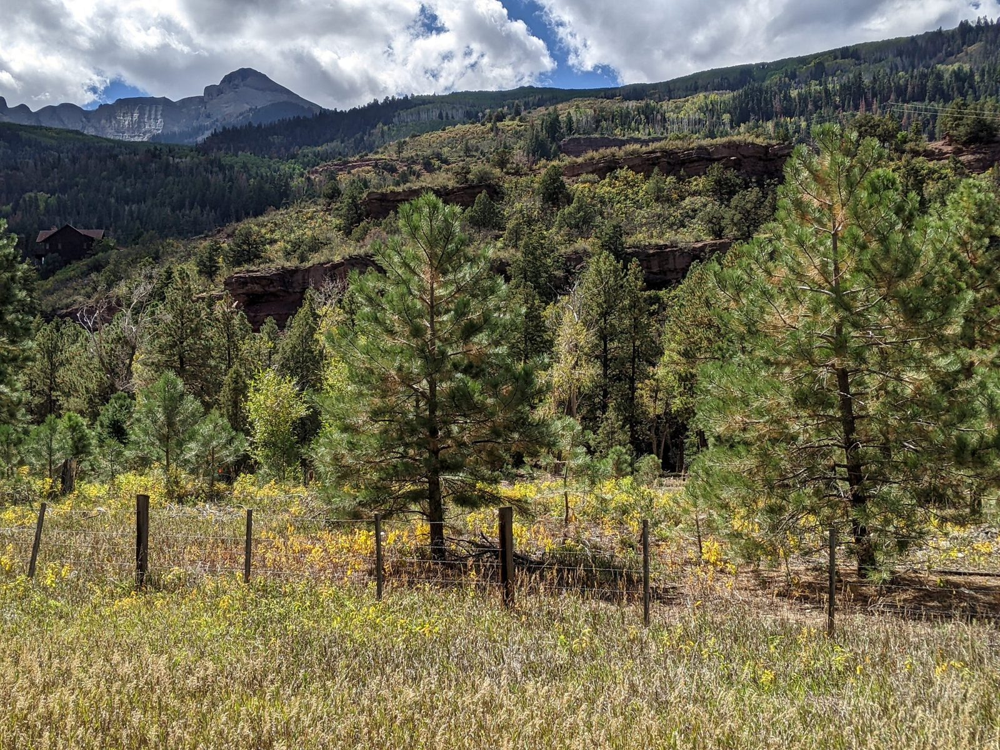

* * *

on this day

my sense

got lost

next to you

the sea of gold

grasses waving

to the wind

the mint green meadow

caught my wandering

attention

on this day

i rediscovered

drank in

cornflower

wild roses

poppies

periwinkle

lilac

sun

flower

my being

on this day

i took a bite

of morning

dew tasted true

a frozen crunch

beneath my feet

a droplet like

white vinaigrette

or an icy rain

bantering about
sauntering along
with my tongue

a mushroom soft silence

riding velvetly above

my joyous golden apple heart

it all feels so natural

* * *

20220925
