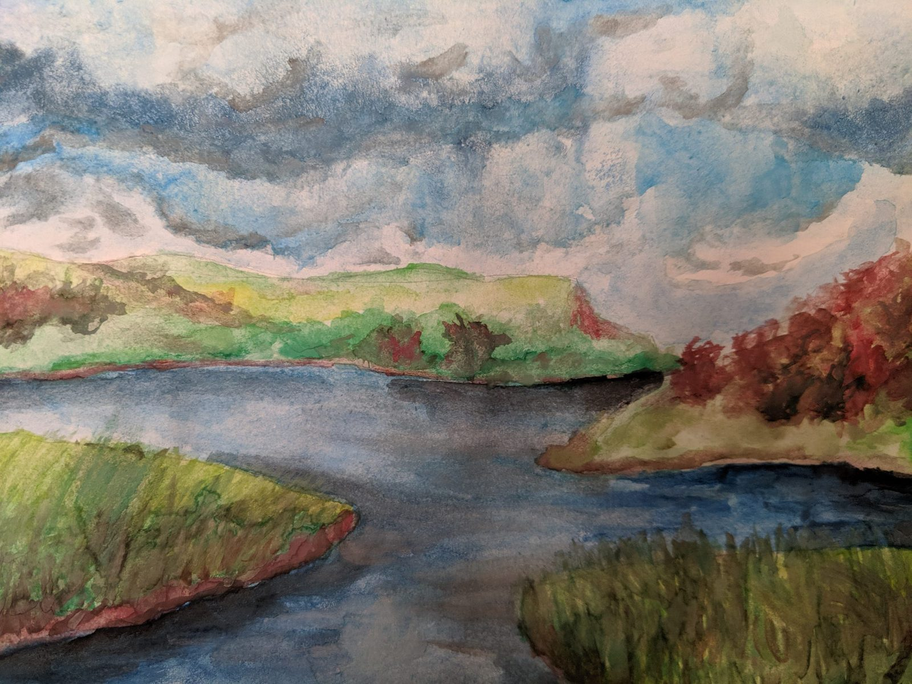

* * *

Plain happy thoughts
Stampede mah shivrin' muscles
From shackles and the fenced corrals
That I’d so will-in chosn were
Shattered by a lightn’n strike
Upon the wind-swept ground
Now, I'm free. Free to roam!
Upon the open range
Like buffalo
Once did

* * *

*201909*
