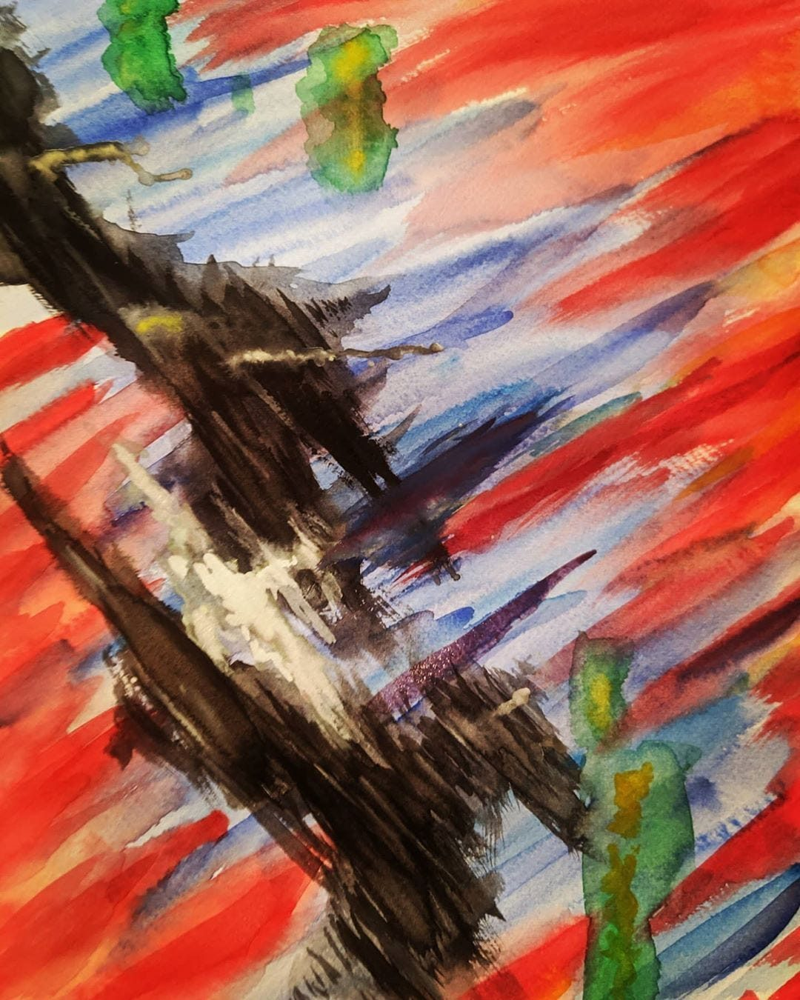

*Watercolor, “Pandemerica” Jennifer D. Carlston*

* * *

chaos reigns
the blue devils
kneel before their
god

* * *

i… can’t… breathe…
cries the ̶w̶o̶man \*black
because it matters
unequally

* * *

trample ’em down
choke ’em out
feed the system swine
their greenery

* * *

i… can’t… breathe…
cries the ̶w̶o̶man \*black
because it matters
unequally

* * *

red riots volcano
erupt in violence
pressure cooked
potato offensives

* * *

i… can’t… breathe…
cries the ̶w̶o̶man \*black
because it matters
unequally

* * *

i… can’t… breathe…
cries human .…. ̶k̶i̶n̶d̶
kithe and kine *faces it*
killed, discriminately

* * *

by a viral yellow brick load
