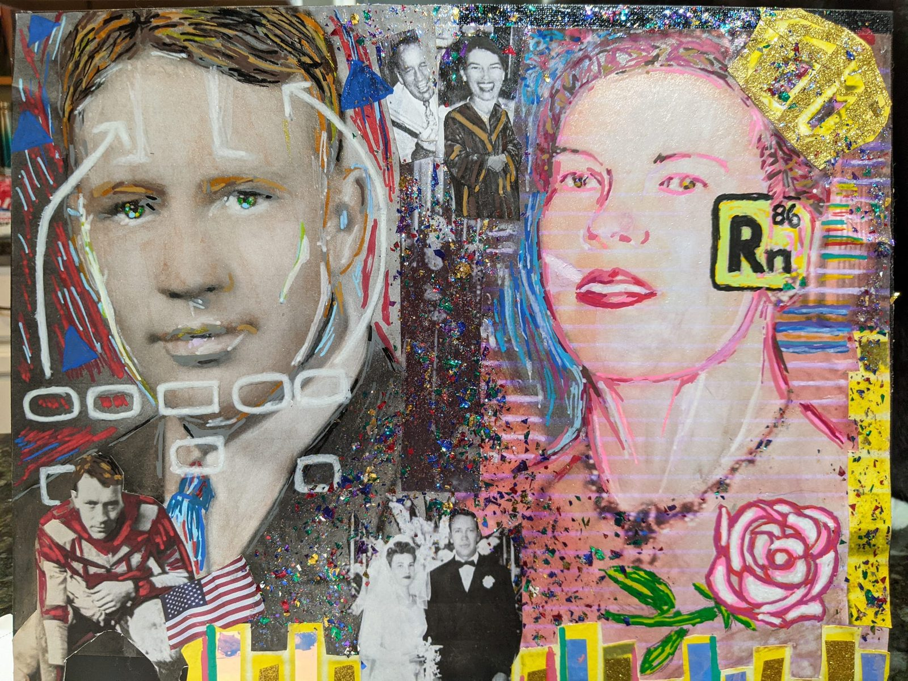

the warmth of homemade soup on a cold day dawnlight breaking through the clouds after an anxious night in the hospital a busy burst of excitement to share what happened the the first day of a baby’s first crying breath a new job swimming in an ocean rippling with tropical fish dancing in the moonlight by a northern spring seeing the milky way fill the sky far away from walking down the street in bright city lights and sounds car horns honking sirens bouncing off the buildings driving late at night through the forest walking silently holding hands in the desert waves kissing in echoes on the beach cove gulls crying in circles round the harbor searching for a hand, a foot, in the wee hours knowing that they’ll be there in the morning waking your eyes filled with joy at the sight

* * *

* * *

*202005*
